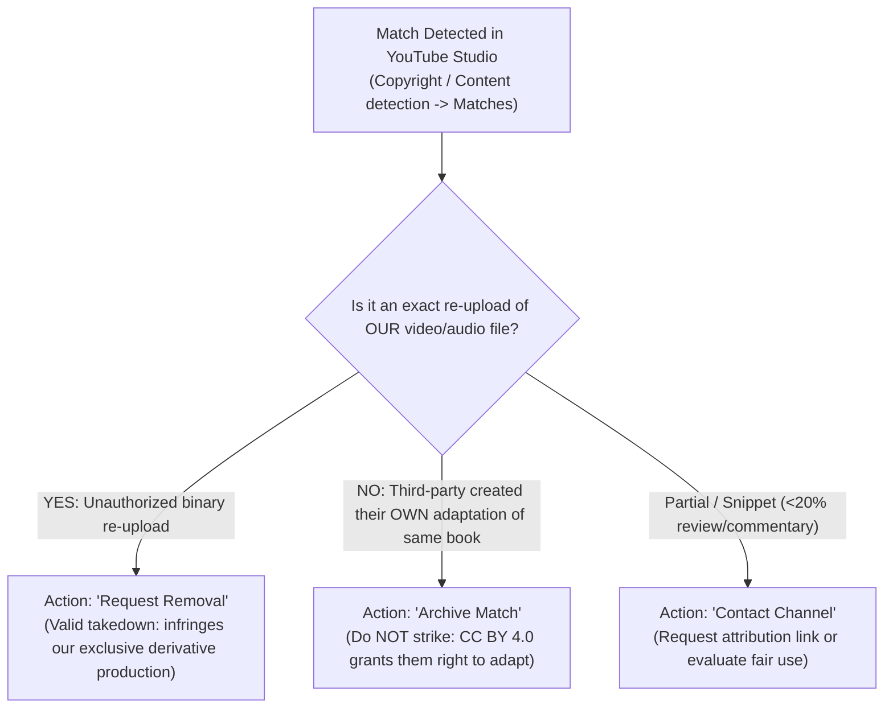

# YouTube Copyright Match Tool & Open-License Compliance Guide

This guide defines the copyright compliance, intellectual property boundaries, attribution standards, and enforcement protocols for all storybook animations produced and published by this project, verified against official Google Support guidelines: [**Use the Copyright Match Tool (support.google.com/youtube/answer/7648743)**](https://support.google.com/youtube/answer/7648743?hl=en-GB).

---

## 1. Legal Foundation & Creative Commons Attribution (CC BY 4.0)

All children's storybooks in this project are derived from open-access children's literature (primarily **StoryWeaver / Pratham Books**):

* **License**: *Creative Commons Attribution 4.0 International (CC BY 4.0)*.
* **Permitted Scope**: Free to share, adapt, translate, animate, and commercialize.
* **Mandatory Attribution**: Every upload must provide clear attribution to the original author, illustrator, publisher, and license.

### Standard Video Description Attribution Block
Every video published to YouTube must include this standardized attribution section in its description:

```markdown
📜 LISENSI & ATRIBUSI:
Buku ini diadaptasi dari buku cerita terbuka berlisensi Creative Commons:
• Judul Asli: <Original Title>
• Penulis: <Original Author>
• Ilustrator Asli: <Original Illustrator>
• Penerbit Asli: Pratham Books (StoryWeaver)
• Sumber Buku: <Source URL>
• Lisensi: Creative Commons Attribution 4.0 International (CC BY 4.0)
  https://creativecommons.org/licenses/by/4.0/

🎬 KREDIT PRODUKSI:
• Voiceover: Licensed Azure Neural Speech (id-ID-GadisNeural & en-US-AnaNeural)
• Audio Engineering: Precise Word Boundary Subtitle Sync & SFX Layering
• Visual & Video Engine: Storybook Video Generator powered by Remotion
• Channel: Zayn Adyan Ramadhan (@ZaynAdyanRamadhan)
```

---

## 2. Ownership Boundaries: Derivative Works vs Public Open License

To comply with YouTube's copyright policies, it is critical to distinguish between **exclusive** and **non-exclusive** rights:

```
┌────────────────────────────────────────────────────────────────────────┐
│                      WHAT WE OWN (EXCLUSIVE RIGHTS)                    │
│  • Synthesized voiceover audio recordings (Azure Neural Speech)        │
│  • Remotion animation keyframes, camera pans, and motion layout        │
│  • Kinetic karaoke subtitle timing and typographical design            │
│  • Sound design, Foley layering, and audio ducking master              │
│  • Custom high-CTR composite thumbnails (Popular & Bedtime editions)   │
│  • Moral of the story outro cards                                      │
└────────────────────────────────────────────────────────────────────────┘
                                     vs
┌────────────────────────────────────────────────────────────────────────┐
│                   WHAT WE DO NOT OWN (NON-EXCLUSIVE)                   │
│  • The underlying story plot, manuscript text, and character names     │
│  • The open-license source illustrations published under CC BY 4.0     │
│  (Other creators have the legal right to create their own adaptations) │
└────────────────────────────────────────────────────────────────────────┘
```

---

## 3. YouTube Copyright Match Tool Protocols (`answer/7648743`)

The **Copyright Match Tool** automatically identifies full or near-full re-uploads of your videos across other YouTube channels.

### A. First-to-Upload Principle
YouTube's matching algorithm evaluates videos uploaded **after** your publication date. Being the first to publish the animated edition on YouTube establishes primary matching authority in YouTube Studio.

### B. Prohibited Claims & Misuse Warning
Google strictly monitors usage of the Copyright Match Tool. Submitting fraudulent or careless copyright takedowns can result in **loss of feature access** or **channel termination**:
* **Prohibited Claims**: You **MUST NOT** file copyright removal requests against videos containing:
  1. Public domain material
  2. Open-license or Creative Commons content (such as other creators adapting the same CC BY 4.0 story)
  3. Content licensed non-exclusively
  4. Valid Fair Use / Fair Dealing transformations

### C. Decision Flow in YouTube Studio



---

## 4. Verification & Audit Checklist

1. **Pre-Publishing**:
   - [x] Full CC BY 4.0 attribution block in `exports/youtube-upload-metadata.md`.
   - [x] Audio assets 100% royalty-free and Content ID safe.
   - [x] Zero third-party logos or trademarked characters.
2. **Post-Publishing**:
   - [x] In [YouTube Studio](https://studio.youtube.com) $\to$ **Content**, verify the **Restrictions** column states **None** (*Tidak ada*) for all videos.
   - [x] Periodically check **YouTube Studio $\to$ Copyright $\to$ Matches** to monitor unauthorized copies.
