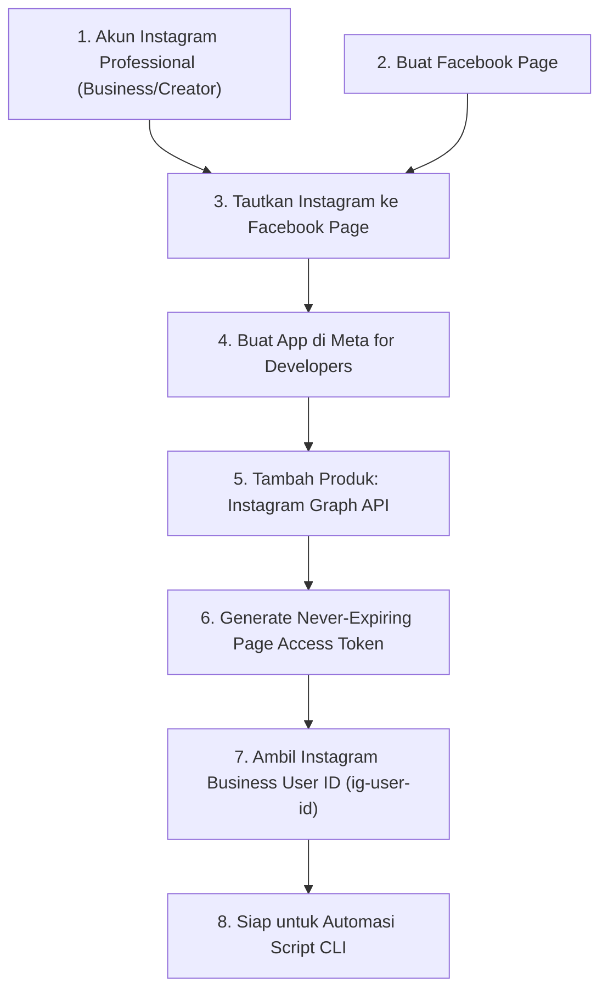

# Panduan Lengkap Registrasi & Setup Meta for Developers (Instagram Reels & Facebook Pages)

Panduan langkah demi langkah untuk mengonfigurasi **Meta for Developers**, mendapatkan **Page Access Token (Permanent / Never Expire)**, dan menemukan **Instagram Business Account ID (`ig-user-id`)** untuk automasi upload video & Reels.

---

## Ringkasan Alur Kerja



---

## Tahap 1: Prasyarat Akun (Wajib)

API Meta **tidak mengizinkan** akun Instagram personal untuk upload via API.

1. **Ubah Instagram ke Akun Profesional**:
   - Buka aplikasi Instagram di HP ➔ Buka Profil ➔ Menu (Garis tiga) ➔ **Pengaturan dan Privasi**.
   - Gulir ke **Untuk profesional** ➔ Pilih **Jenis dan fitur akun** ➔ **Beralih ke Akun Profesional**.
   - Pilih kategori (misal: *Creator* atau *Pendidikan/Buku*) ➔ Pilih tipe **Creator** atau **Bisnis**.
2. **Buat Facebook Page (Halaman Facebook)**:
   - Buka [facebook.com/pages/create](https://www.facebook.com/pages/create) menggunakan akun Facebook Anda.
   - Beri nama Halaman (misal: *Dongeng & Cerita Anak* atau nama brand Anda).
3. **Hubungkan Instagram ke Facebook Page**:
   - Masuk ke Facebook Page Anda ➔ Buka **Settings (Pengaturan)** ➔ **Linked Accounts (Akun Tertaut)**.
   - Klik **Instagram** ➔ Klik **Connect Account (Hubungkan Akun)**.
   - Login ke akun Instagram Anda dan beri izin.

---

## Tahap 2: Mendaftarkan Aplikasi di Meta for Developers

1. Buka portal [Meta for Developers](https://developers.facebook.com/) dan login dengan akun Facebook Anda.
2. Jika baru pertama kali, klik **Get Started / Mulai** di pojok kanan atas untuk verifikasi nomor HP dan akun developer.
3. Klik **My Apps (Aplikasi Saya)** di menu atas ➔ Klik tombol hijau **Create App (Buat Aplikasi)**.
4. Pada pilihan Use Case / Tipe Aplikasi:
   - Pilih **Other (Lainnya)** ➔ Klik **Next**.
   - Pilih tipe **Business (Bisnis)** ➔ Klik **Next**.
5. Isi detail aplikasi:
   - **App Name**: Misal `Storybook Video Uploader`.
   - **App Contact Email**: Email aktif Anda.
   - **Business Account**: Pilih Akun Bisnis Meta Anda (jika ada, atau lewati jika opsional).
   - Klik **Create App**.

---

## Tahap 3: Menambahkan Produk Instagram Graph API

1. Di Dashboard Aplikasi yang baru dibuat, masuk ke bagian **Add products to your app (Tambahkan produk ke aplikasi Anda)**.
2. Temukan kartu **Instagram** (atau **Instagram Graph API**) ➔ Klik tombol **Set Up (Siapkan)**.
3. Masuk ke menu **Instagram** di sidebar kiri ➔ **Basic Display** atau **Settings**:
   - Di bagian **Valid OAuth Redirect URIs**, masukkan `http://localhost:3000/callback` (atau biarkan default untuk pengujian lokal).

---

## Tahap 4: Generate Token Permanen ("Never Expire")

Secara default, token Meta kadaluarsa dalam 1–2 jam. Agar script Node.js kita bisa berjalan otomatis kapan saja tanpa login ulang berulang kali, kita generate **Never-Expiring Page Access Token**.

### Langkah 4.1: Buka Graph API Explorer
Buka [Meta Graph API Explorer](https://developers.facebook.com/tools/explorer/).

1. Di panel kanan atas:
   - **Meta App**: Pilih aplikasi yang baru Anda buat (`Storybook Video Uploader`).
   - **User or Page**: Pilih **User Token**.
2. Di bagian **Permissions (Izin)**, tambahkan izin berikut:
   - `instagram_basic`
   - `instagram_content_publish`
   - `pages_show_list`
   - `pages_read_engagement`
   - `pages_manage_posts`
3. Klik tombol biru **Generate Access Token**.
4. Akan muncul popup Facebook ➔ Berikan izin akses untuk Facebook Page dan Akun Instagram Anda.
5. Anda sekarang memegang **Short-Lived User Access Token** (berlaku ~1-2 jam).

---

### Langkah 4.2: Konversi ke Long-Lived Token (60 Hari)
Jalankan perintah HTTP GET berikut di browser atau terminal Anda (ganti nilai yang dikurung):

```bash
curl -X GET "https://graph.facebook.com/v21.0/oauth/access_token?\
grant_type=fb_exchange_token&\
client_id={YOUR_APP_ID}&\
client_secret={YOUR_APP_SECRET}&\
fb_exchange_token={SHORT_LIVED_USER_TOKEN}"
```

> **Catatan**: `YOUR_APP_ID` dan `YOUR_APP_SECRET` dapat dilihat di Dashboard Meta for Developers ➔ **App settings (Pengaturan aplikasi)** ➔ **Basic (Dasar)**.

Responnya akan menghasilkan token baru (`access_token`). Ini adalah **Long-Lived User Token** (berlaku 60 hari).

---

### Langkah 4.3: Ambil Page Access Token yang "Never Expires"
Gunakan **Long-Lived User Token** dari Langkah 4.2 di Graph API Explorer untuk memanggil endpoint halaman Anda:

```http
GET https://graph.facebook.com/v21.0/me/accounts?access_token={LONG_LIVED_USER_TOKEN}
```

Respon JSON akan menampilkan daftar Facebook Page Anda:
```json
{
  "data": [
    {
      "access_token": "EAAXxxxx... (INILAH TOKEN PERMANEN ANDA!)",
      "category": "Education",
      "name": "Dongeng & Cerita Anak",
      "id": "123456789012345"
    }
  ]
}
```

1. Simpan nilai `id` halaman ini sebagai **`FACEBOOK_PAGE_ID`**.
2. Simpan nilai `access_token` halaman ini sebagai **`PAGE_ACCESS_TOKEN`**.
3. **Verifikasi Token**: Buka [Meta Access Token Debugger](https://developers.facebook.com/tools/debug/), masukkan token tersebut. Di kolom **Expires**, statusnya akan tertulis: **"Never"**!

---

## Tahap 5: Mendapatkan Instagram Business Account ID (`ig-user-id`)

Dengan `PAGE_ACCESS_TOKEN` di atas, panggil endpoint Facebook Page untuk mengambil ID Instagram yang terhubung:

```http
GET https://graph.facebook.com/v21.0/{FACEBOOK_PAGE_ID}?fields=instagram_business_account&access_token={PAGE_ACCESS_TOKEN}
```

Respon JSON:
```json
{
  "instagram_business_account": {
    "id": "17841400000000000"
  },
  "id": "{FACEBOOK_PAGE_ID}"
}
```

Simpan nilai `instagram_business_account.id` ini sebagai **`INSTAGRAM_USER_ID`**.

---

## Tahap 6: Menyimpan Konfigurasi ke Proyek Kita

Simpan kredensial ini di file konfigurasi lokal kita (misal: `config/meta-config.json`):

```json
{
  "appId": "YOUR_APP_ID",
  "appSecret": "YOUR_APP_SECRET",
  "facebookPageId": "123456789012345",
  "instagramUserId": "17841400000000000",
  "pageAccessToken": "EAAYyyyy... (Never Expire Token)"
}
```

*(Pastikan file konfigurasi token ini sudah terdaftar di `.gitignore` agar aman dari commit).*

---

## Keuntungan Menggunakan Pengaturan Ini

1. **Bebas App Review untuk Akun Sendiri**:
   - Selama video diposting ke Facebook Page dan Akun Instagram milik developer/admin aplikasi, Meta **tidak mewajibkan App Review**. Anda bisa langsung mengunggah konten secara otomatis tanpa antrean verifikasi!
2. **Satu Token untuk 2 Platform**:
   - `PAGE_ACCESS_TOKEN` yang sama dapat digunakan untuk mempublikasikan:
     - **Instagram Reels** (Format 9:16)
     - **Facebook Reels** (Format 9:16)
     - **Facebook Page Video Feed** (Format 16:9 Long-Form)
