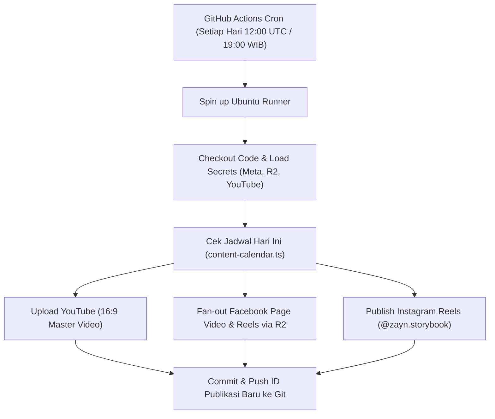

# Kalender Produksi & Jadwal Rilis Harian (Bulan 1: November – Desember 2026)
**Zayn Storybook Channel (@zayn.storybook)**
*Mode: Daily Continuous Production & Automated Cloud Broadcast (7 Hari Seminggu)*

---

## 1. Strategi Produksi & Rilis Harian (Daily Cadence)

Menjawab target **produksi setiap hari**:
1. **Ritme Harian (Daily Production)**: Setiap hari diproduksi 1 paket cerita/edisi baru lengkap (Plates -> Audio TTS -> Thumbnails -> Video 16:9 & 9:16).
2. **Jam Tayang Emas (Golden Hour - 19:00 WIB)**: GitHub Actions Cron berjalan otomatis setiap hari pukul **12:00 UTC (19:00 WIB)** untuk mempublikasikan edisi terjadwal ke **YouTube**, **Facebook Watch/Reels**, dan **Instagram Reels**.
3. **Keseimbangan Format & Bahasa**:
   - **Senin, Rabu, Jumat**: Rilis Cerita Baru (Edisi Bahasa Indonesia).
   - **Selasa, Kamis**: Rilis Cerita Baru (Edisi English Read-Aloud).
   - **Sabtu Pagi (08:30 WIB)**: Morning Humor Short / Reels (Keceriaan Akhir Pekan).
   - **Sabtu Malam (19:00 WIB)**: Saturday Family Prime Special.
   - **Minggu Malam (19:30 WIB)**: Mega Bedtime Marathon (~15–20 Menit) untuk retensi tontonan panjang anak sebelum tidur.

---

## 2. Kurasi Cerita: 100% Ilustrasi Asli (Authentic Plates CC BY 4.0)

> **Kebijakan Produksi Terkini**: Mengabaikan sementara seluruh cerita yang membutuhkan AI Generation. Seluruh judul 100% menggunakan buku cerita anak berlisensi terbuka (**StoryWeaver / Pratham Books CC BY 4.0**) dengan ilustrasi asli karya ilustrator profesional dunia yang diinpaint otomatis melalui Apple Vision OCR Engine (`npm run plates`).

### Daftar Storybook Ilustrasi Asli Pilihan:
1. **Terlalu Banyak Suara! (*Too Much Noise!*)** — Sringeri Srinivas #3 (Humor klakson & headphone)
2. **Sringeri Srinivas Belajar Tertawa (*Sringeri Srinivas Learns to Laugh*)** — Sringeri Srinivas #4 (Slapstick monyet & pisang)
3. **Tersenyumlah! (*Smile Please!*)** — Rusa & senyum hewan hutan (Favorit balita)
4. **Ada Monster di Bawah Tempat Tidurku?! (*Under My Bed*)** — Niche *bedtime fears* & komedi
5. **Kue Ulang Tahun untuk Mimi (*A Birthday Cake for Mimi*)** — Memasak kue & hewan ceria
6. **Baju Baru Sang Kodok (*The Frog's New Clothes*)** — Fabel percaya diri
7. **Bima si Tukang Tidur (*Bheema the Sleepyhead*)** — Kisah banteng raksasa menggemaskan yang hobi tidur di sembarang tempat
8. **Payung Merah (*The Red Umbrella*)** — Kisah petualangan payung merah terbang menyelamatkan hewan dari hujan
9. **Bagaimana Jika? (*What If?*)** — Kisah imajinasi seru rasa ingin tahu anak
10. **Hari Cukur Rambut (*Annual Haircut Day*)** — Sringeri Srinivas #1 (Petualangan rambut lebat)
11. **Pisang Terlalu Banyak (*Too Many Bananas*)** — Sringeri Srinivas #2 (Membuat dodol pisang bersama desa)
12. **Bulan dan Topi Biru (*The Moon and the Cap*)** — Kisah imajinasi malam & kehangatan keluarga
13. **Gara-Gara Kucing (*It's All the Cat's Fault*)** — Cerita tanggung jawab PR sekolah
14. **Raja Gemuk, Anjing Kurus (*Fat King, Thin Dog*)** — Olahraga lari bersama anjing
15. **Jas Hujan Merah (*The Red Raincoat*)** — Menunggu hujan & kesabaran

---

## 3. Matriks Jadwal Rilis Harian (30 Hari Penuh: 7 Nov – 6 Des 2026)
*Seluruh Konten 100% Ilustrasi Asli (Zero AI)*

| Hari & Tanggal | Jam Tayang | Judul Cerita | Bahasa | Format Rilis | Target Platform |
|:---|:---:|---|:---:|:---:|---|
| **Sab, 7 Nov** | 19:30 WIB | Terlalu Banyak Suara! | ID | 16:9 & 9:16 | YouTube, FB Watch, IG Reels |
| **Min, 8 Nov** | 19:00 WIB | Too Much Noise! | EN | 16:9 & 9:16 | YouTube, FB Watch, IG Reels |
| **Sen, 9 Nov** | 19:00 WIB | Sringeri Srinivas Belajar Tertawa | ID | 16:9 & 9:16 | YouTube, FB Watch, IG Reels |
| **Sel, 10 Nov** | 19:00 WIB | Sringeri Srinivas Learns to Laugh | EN | 16:9 & 9:16 | YouTube, FB Watch, IG Reels |
| **Rab, 11 Nov** | 19:00 WIB | Tersenyumlah! | ID | 16:9 & 9:16 | YouTube, FB Watch, IG Reels |
| **Kam, 12 Nov** | 19:00 WIB | Smile Please! | EN | 16:9 & 9:16 | YouTube, FB Watch, IG Reels |
| **Jum, 13 Nov** | 19:30 WIB | Ada Monster di Bawah Tempat Tidurku?! | ID | 16:9 & 9:16 | YouTube, FB Watch, IG Reels |
| **Sab, 14 Nov** | 08:30 WIB | Terlalu Banyak Suara (Klakson Lucu!) | ID | 9:16 Short | Shorts, IG Reels, FB Reels, TikTok |
| **Sab, 14 Nov** | 19:00 WIB | Under My Bed | EN | 16:9 & 9:16 | YouTube, FB Watch, IG Reels |
| **Min, 15 Nov** | 19:30 WIB | **MARATHON 1: Kompilasi 4 Kisah Sringeri Srinivas** | ID | 16:9 (~15m) | YouTube Master & FB Watch |
| **Sen, 16 Nov** | 19:00 WIB | Kue Ulang Tahun untuk Mimi | ID | 16:9 & 9:16 | YouTube, FB Watch, IG Reels |
| **Sel, 17 Nov** | 19:00 WIB | A Birthday Cake for Mimi | EN | 16:9 & 9:16 | YouTube, FB Watch, IG Reels |
| **Rab, 18 Nov** | 19:00 WIB | Baju Baru Sang Kodok | ID | 16:9 & 9:16 | YouTube, FB Watch, IG Reels |
| **Kam, 19 Nov** | 19:00 WIB | The Frog's New Clothes | EN | 16:9 & 9:16 | YouTube, FB Watch, IG Reels |
| **Jum, 20 Nov** | 19:30 WIB | Bima si Tukang Tidur | ID | 16:9 & 9:16 | YouTube, FB Watch, IG Reels |
| **Sab, 21 Nov** | 08:30 WIB | Monyet dan Kulit Pisang Srinivas | ID | 9:16 Short | Shorts, IG Reels, FB Reels |
| **Sab, 21 Nov** | 19:00 WIB | Bheema the Sleepyhead | EN | 16:9 & 9:16 | YouTube, FB Watch, IG Reels |
| **Min, 22 Nov** | 19:30 WIB | **MARATHON 2: Fabel Binatang Lucu Pengantar Tidur** | ID | 16:9 (~15m) | YouTube Master & FB Watch |
| **Sen, 23 Nov** | 19:00 WIB | Payung Merah | ID | 16:9 & 9:16 | YouTube, FB Watch, IG Reels |
| **Sel, 24 Nov** | 19:00 WIB | The Red Umbrella | EN | 16:9 & 9:16 | YouTube, FB Watch, IG Reels |
| **Rab, 25 Nov** | 19:00 WIB | Bagaimana Jika? | ID | 16:9 & 9:16 | YouTube, FB Watch, IG Reels |
| **Kam, 26 Nov** | 19:00 WIB | What If? | EN | 16:9 & 9:16 | YouTube, FB Watch, IG Reels |
| **Jum, 27 Nov** | 19:30 WIB | Jas Hujan Merah (Remastered) | ID | 16:9 & 9:16 | YouTube, FB Watch, IG Reels |
| **Sab, 28 Nov** | 08:30 WIB | Bima Si Banteng Ketiduran di Jalan | ID | 9:16 Short | Shorts, IG Reels, FB Reels |
| **Sab, 28 Nov** | 19:00 WIB | The Red Raincoat (Encore) | EN | 16:9 & 9:16 | YouTube, FB Watch, IG Reels |
| **Min, 29 Nov** | 19:30 WIB | **MARATHON 3: Dongeng Pengantar Tidur Menenangkan** | ID | 16:9 (~16m) | YouTube Master & FB Watch |
| **Sen, 30 Nov** | 19:00 WIB | Hari Cukur Rambut (Remastered) | ID | 16:9 & 9:16 | YouTube, FB Watch, IG Reels |
| **Sel, 1 Des** | 19:00 WIB | Annual Haircut Day (Encore) | EN | 16:9 & 9:16 | YouTube, FB Watch, IG Reels |
| **Rab, 2 Des** | 19:00 WIB | Pisang Terlalu Banyak (Remastered) | ID | 16:9 & 9:16 | YouTube, FB Watch, IG Reels |
| **Kam, 3 Des** | 19:00 WIB | Too Many Bananas (Encore) | EN | 16:9 & 9:16 | YouTube, FB Watch, IG Reels |
| **Jum, 4 Des** | 19:30 WIB | Bulan dan Topi Biru (Encore) | ID | 16:9 & 9:16 | YouTube, FB Watch, IG Reels |
| **Sab, 5 Des** | 19:00 WIB | Gara-Gara Kucing (Remastered) | ID | 16:9 & 9:16 | YouTube, FB Watch, IG Reels |
| **Min, 6 Des** | 19:30 WIB | **MEGA MARATHON: 60 Menit Dongeng Terpopuler Zayn** | Bilingual | 16:9 (~60m) | YouTube Public & FB Watch |

---

## 4. Cara Kerja Otomatisasi GitHub Actions Cron

File Workflow: `.github/workflows/daily-broadcast.yml`

1. **Jadwal Tanpa Laptop Nyala**: Karena dieksekusi di server GitHub Actions, komputer lokal Anda tidak perlu menyala pada jam tayang.
2. **Instagram Reels Terjadwal**: Script memanggil API Instagram Container tepat pada jam 19:00 WIB, mengatasi keterbatasan Instagram Graph API yang tidak punya scheduler server-side.
3. **Sinkronisasi Otomatis**: Setiap video yang berhasil tayang dicatat ke dalam `story.json` dan otomatis di-push kembali ke branch `main`.
