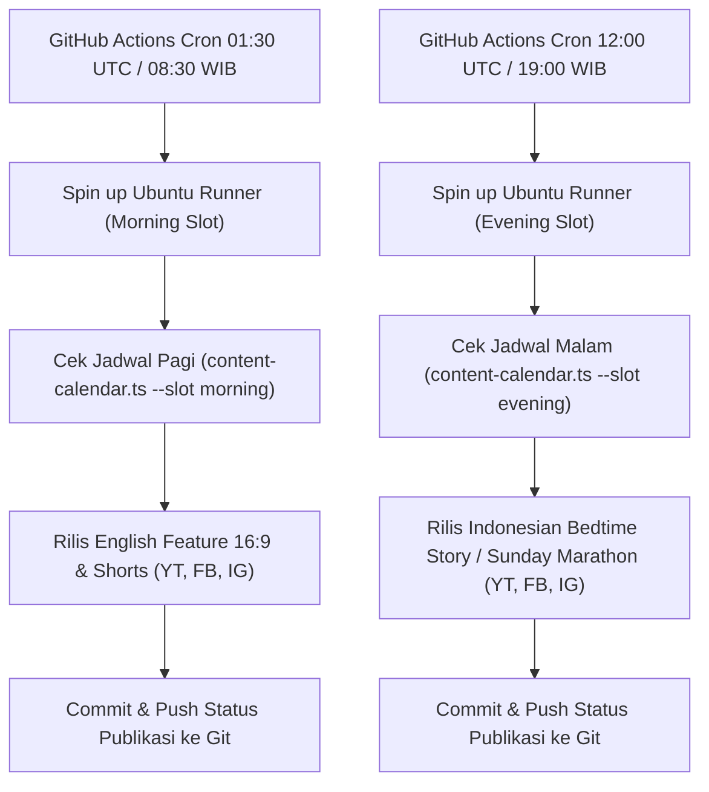

# Kalender Produksi & Jadwal Rilis Harian (Bulan 1: November – Desember 2026)
**Zayn Storybook Channel (@zayn.storybook)**
*Mode: Daily Continuous Production & Automated Cloud Broadcast (7 Hari Seminggu)*

---

## 1. Strategi Produksi & Rilis Harian (Daily Cadence)

Menjawab target **produksi setiap hari dengan konten cerita baru yang segar tanpa pengulangan (Zero Duplication)**:
1. **Ritme Harian (Daily Production)**: Setiap hari diproduksi 1 paket cerita baru lengkap berlisensi terbuka (*Authentic Plates CC BY 4.0* -> Audio TTS Dual Bahasa -> 10 Varian Thumbnail -> Video 16:9 & 9:16).
2. **Jadwal Tayang Ganda Harian (Dual Golden Hour Cadence)**:
   - **Pagi Hari (08:30 WIB)**: *Morning English Feature* (Edisi Bahasa Inggris 16:9 & Shorts 9:16) — dirancang untuk keceriaan pagi, pengenalan bahasa Inggris interaktif, dan eksposur algoritma global.
   - **Malam Hari (19:00 WIB)**: *Prime Bedtime Story* (Edisi Bahasa Indonesia 16:9 & Shorts 9:16) — jam emas anak bersiap tidur dengan narasi hangat penuh pesan moral.
3. **Mega Bedtime Marathon (Minggu Malam, 19:30 WIB)**:
   - Khusus hari Minggu malam, ditayangkan **Kompilasi Marathon (16:9 ~20–60 Menit)** yang merangkum cerita-cerita pilihan pekan tersebut. Ini adalah **satu-satunya format pengulangan**, khusus untuk menahan retensi tontonan panjang (*binge-watching*) sebelum tidur.
4. **Kebijakan Anti-Duplikasi (Zero Daily Duplication)**:
   - Selama 30 hari penuh (7 Nov – 6 Des 2026), **setiap hari menampilkan 1 judul buku cerita baru yang berbeda**.
   - Tidak ada cerita lama yang diputar ulang sebagai *Encore* atau *Remastered* di slot rilis harian.

---

## 2. Kurasi Cerita: 100% Ilustrasi Asli (Authentic Plates CC BY 4.0)

> **Kebijakan Produksi**: 100% menggunakan buku cerita anak pilihan berlisensi terbuka (**StoryWeaver / Pratham Books CC BY 4.0**) dengan ilustrasi karya ilustrator profesional dunia yang diinpaint otomatis melalui Apple Vision OCR Engine (`npm run plates`) dan dipadukan dengan *Organic Ambient Vignette & Delicate Cloud Mist*.

### Daftar 26 Storybook Ilustrasi Asli Unik (Bulan 1):
1. **Terlalu Banyak Suara! (*Too Much Noise!*)** — Radhika Bapat, illus. Ruchi Shah (Sringeri Srinivas & headphone ajaib)
2. **Semua Serba Terbalik! (*Topsy Turvy*)** — Rohini Nilekani, illus. Angie & Upesh (Kamar ajaib jungkir balik)
3. **Misteri Kacamata Nenek (*Grandma's Glasses*)** — Rohini Nilekani, illus. Angie & Upesh (Kasih sayang cucu & petualangan kacamata)
4. **Jangan Sekarang, Tunggu Dulu! (*Not Now, Not Now!*)** — Rohini Nilekani, illus. Angie & Upesh (Belajar sabar menanti kejutan keluarga)
5. **Mendengarkan Tubuhku (*Listen to My Body*)** — Rohini Nilekani, illus. Angie & Upesh (Mengenal detak jantung & keajaiban tubuh)
6. **Ada Harimau di Bawah Tempat Tidurku! (*Under My Bed*)** — Rohini Nilekani, illus. Angie & Upesh (Mengatasi rasa takut gelap dengan imajinasi jenaka)
7. **Tersenyumlah! (*Smile Please!*)** — Sanjiv Jaiswal 'Sanjay', illus. Ajanta Guhathakurta (Senyuman rusa & hewan hutan)
8. **Kue Ulang Tahun untuk Mimi (*A Birthday Cake for Mimi*)** — Jaclyn Lee, illus. Angie & Upesh (Memasak kue ulang tahun & kebersamaan sahabat)
9. **Sringeri Srinivas Belajar Tertawa (*Sringeri Srinivas Learns to Laugh*)** — Rohini Nilekani, illus. Angie & Upesh (Monyet usil & tawa lepas Pak Srinivas)
10. **Baju Baru Sang Kodok (*The Frog's New Clothes*)** — Madhuri Pai, illus. Rijuta Ghate (Fabel percaya diri & bersyukur apa adanya)
11. **Bima si Tukang Tidur (*Bheema the Sleepyhead*)** — Cheryl Rao, illus. Saurabh Pandey (Banteng raksasa menggemaskan yang hobi tidur)
12. **Payung Merah (*The Red Umbrella*)** — Nandini Nayar, illus. Ashutosh Pathak (Payung merah terbang menolong sahabat di musim hujan)
13. **Bagaimana Jika? (*What If?*)** — Hari Kumar, illus. Sonal Goyal & Sumit Sakhuja (Rasa ingin tahu anak: awan es krim & ikan terbang)
14. **Siapa yang Mengambil Apelku? (*Who Took My Apple?*)** — Pratham Books, illus. Rajiv Eipe (Teka-teki seru jejak hewan di kebun apel)
15. **Burung Gagak yang Cerdik (*The Clever Crow*)** — Venkatramana Gowda, illus. Padmanabh (Fabel klasik kecerdikan memecahkan masalah)
16. **Katak yang Ingin Terbang (*The Frog Who Wanted to Fly*)** — Sanjiv Jaiswal, illus. Shilpa Ranade (Semangat pantang menyerah & persahabatan)
17. **Awan Kecil yang Haus (*The Little Thirsty Cloud*)** — Sanjiv Jaiswal, illus. Ajanta Guhathakurta (Perjalanan awan membasahi padang bunga)
18. **Kupu-Kupu Sayap Pelangi (*The Butterfly with Rainbow Wings*)** — Rohini Nilekani, illus. Angie & Upesh (Keindahan berbagi warna di taman)
19. **Milo Si Anak Gajah (*Milo The Little Elephant*)** — Sheila Dhir, illus. Suddhasattwa Basu (Menemukan keistimewaan belalai anak gajah)
20. **Layang-Layang Kiki yang Terbang Tinggi (*Kiki's Flying Kite*)** — Subhadra Sen Gupta, illus. Tapas Guha (Keceriaan angin sore di padang rumput)
21. **Roti Terbang yang Lari (*The Runaway Chapati*)** — Rohini Nilekani, illus. Angie & Upesh (Komedi dapur mengejar roti yang menggelinding kabur)
22. **Dua Kambing dan Jembatan Sempit (*The Two Goats*)** — Sanjiv Jaiswal, illus. Ajanta Guhathakurta (Pentingnya mengalah & kerja sama)
23. **Burung Hantu Cilik yang Takut Gelap (*The Owl Who Was Afraid of the Dark*)** — Shamim Padamsee, illus. Ashutosh Pathak (Keindahan bintang dan malam yang damai)
24. **Sepatu Merah Kiki (*Red Shoes for Kiki*)** — Vibha Batra, illus. Sonal Goyal (Kemandirian memakai sepatu baru)
25. **Ikan Emas Berenang Bebas (*The Golden Fish*)** — Cheryl Rao, illus. Saurabh Pandey (Kasih sayang merawat dan membebaskan makhluk hidup)
26. **Sahabat di Atas Pohon (*Friends in the Trees*)** — Nandini Nayar, illus. Ruchi Shah (Persahabatan hangat tupai dan burung pipit)

---

## 3. Matriks Jadwal Rilis Harian (30 Hari Penuh: 7 Nov – 6 Des 2026)
*Bebas Pengulangan Harian (Zero Daily Duplication) | 100% Lisensi Terbuka CC BY 4.0*

| Hari & Tanggal | Jam Tayang | Judul Cerita | Bahasa | Format Rilis | Target Platform | Status Publikasi |
|:---|:---:|---|:---:|:---:|---|:---:|
| **Sab, 7 Nov** | 19:30 WIB | Terlalu Banyak Suara! | ID | 16:9 & 9:16 | YouTube, FB Watch, IG Reels | ✅ LIVE |
| **Sab, 7 Nov** | 21:00 WIB | Too Much Noise! | EN | 16:9 & 9:16 | YouTube, FB Watch, IG Reels | ✅ LIVE |
| **Min, 8 Nov** | 08:30 WIB | Topsy Turvy | EN | 16:9 & 9:16 | YouTube, FB Watch, IG Reels | ✅ LIVE |
| **Min, 8 Nov** | 19:00 WIB | Semua Serba Terbalik! | ID | 16:9 & 9:16 | YouTube, FB Watch, IG Reels | ✅ LIVE |
| **Sen, 9 Nov** | 08:30 WIB | Grandma's Glasses | EN | 16:9 & 9:16 | YouTube, FB Watch, IG Reels | ✅ LIVE |
| **Sen, 9 Nov** | 19:00 WIB | Misteri Kacamata Nenek | ID | 16:9 & 9:16 | YouTube, FB Watch, IG Reels | ⏳ Terjadwal |
| **Sel, 10 Nov** | 08:30 WIB | Not Now, Not Now! | EN | 16:9 & 9:16 | YouTube, FB Watch, IG Reels | ⏳ Siap Render |
| **Sel, 10 Nov** | 19:00 WIB | Jangan Sekarang, Tunggu Dulu! | ID | 16:9 & 9:16 | YouTube, FB Watch, IG Reels | ⏳ Siap Render |
| **Rab, 11 Nov** | 08:30 WIB | Listen to My Body | EN | 16:9 & 9:16 | YouTube, FB Watch, IG Reels | ⏳ Terjadwal |
| **Rab, 11 Nov** | 19:00 WIB | Mendengarkan Tubuhku | ID | 16:9 & 9:16 | YouTube, FB Watch, IG Reels | ⏳ Terjadwal |
| **Kam, 12 Nov** | 08:30 WIB | Under My Bed | EN | 16:9 & 9:16 | YouTube, FB Watch, IG Reels | ⏳ Terjadwal |
| **Kam, 12 Nov** | 19:00 WIB | Ada Harimau di Bawah Tempat Tidurku! | ID | 16:9 & 9:16 | YouTube, FB Watch, IG Reels | ⏳ Terjadwal |
| **Jum, 13 Nov** | 08:30 WIB | Smile Please! | EN | 16:9 & 9:16 | YouTube, FB Watch, IG Reels | ⏳ Terjadwal |
| **Jum, 13 Nov** | 19:00 WIB | Tersenyumlah! | ID | 16:9 & 9:16 | YouTube, FB Watch, IG Reels | ⏳ Terjadwal |
| **Sab, 14 Nov** | 08:30 WIB | A Birthday Cake for Mimi | EN | 16:9 & 9:16 | YouTube, FB Watch, IG Reels | ⏳ Terjadwal |
| **Sab, 14 Nov** | 19:00 WIB | Kue Ulang Tahun untuk Mimi | ID | 16:9 & 9:16 | YouTube, FB Watch, IG Reels | ⏳ Terjadwal |
| **Min, 15 Nov** | 08:30 WIB | Morning Joy: Hewan Hutan Bergembira | ID | 9:16 Short | Shorts, IG Reels, FB Reels | ⏳ Terjadwal |
| **Min, 15 Nov** | 19:30 WIB | **MARATHON 1: Kompilasi Kehangatan Rumah & Keluarga** | ID | 16:9 (~20m) | YouTube Master & FB Watch | ⏳ Terjadwal |
| **Sen, 16 Nov** | 08:30 WIB | Sringeri Srinivas Learns to Laugh | EN | 16:9 & 9:16 | YouTube, FB Watch, IG Reels | ⏳ Terjadwal |
| **Sen, 16 Nov** | 19:00 WIB | Sringeri Srinivas Belajar Tertawa | ID | 16:9 & 9:16 | YouTube, FB Watch, IG Reels | ⏳ Terjadwal |
| **Sel, 17 Nov** | 08:30 WIB | The Frog's New Clothes | EN | 16:9 & 9:16 | YouTube, FB Watch, IG Reels | ⏳ Terjadwal |
| **Sel, 17 Nov** | 19:00 WIB | Baju Baru Sang Kodok | ID | 16:9 & 9:16 | YouTube, FB Watch, IG Reels | ⏳ Terjadwal |
| **Rab, 18 Nov** | 08:30 WIB | Bheema the Sleepyhead | EN | 16:9 & 9:16 | YouTube, FB Watch, IG Reels | ⏳ Terjadwal |
| **Rab, 18 Nov** | 19:00 WIB | Bima si Tukang Tidur | ID | 16:9 & 9:16 | YouTube, FB Watch, IG Reels | ⏳ Terjadwal |
| **Kam, 19 Nov** | 08:30 WIB | The Red Umbrella | EN | 16:9 & 9:16 | YouTube, FB Watch, IG Reels | ⏳ Terjadwal |
| **Kam, 19 Nov** | 19:00 WIB | Payung Merah | ID | 16:9 & 9:16 | YouTube, FB Watch, IG Reels | ⏳ Terjadwal |
| **Jum, 20 Nov** | 08:30 WIB | What If? | EN | 16:9 & 9:16 | YouTube, FB Watch, IG Reels | ⏳ Terjadwal |
| **Jum, 20 Nov** | 19:00 WIB | Bagaimana Jika? | ID | 16:9 & 9:16 | YouTube, FB Watch, IG Reels | ⏳ Terjadwal |
| **Sab, 21 Nov** | 08:30 WIB | Who Took My Apple? | EN | 16:9 & 9:16 | YouTube, FB Watch, IG Reels | ⏳ Terjadwal |
| **Sab, 21 Nov** | 19:00 WIB | Siapa yang Mengambil Apelku? | ID | 16:9 & 9:16 | YouTube, FB Watch, IG Reels | ⏳ Terjadwal |
| **Min, 22 Nov** | 08:30 WIB | Morning Short: Monyet & Apel Misterius | ID | 9:16 Short | Shorts, IG Reels, FB Reels | ⏳ Terjadwal |
| **Min, 22 Nov** | 19:30 WIB | **MARATHON 2: Kompilasi Fabel Rimba & Hewan Ceria** | ID | 16:9 (~20m) | YouTube Master & FB Watch | ⏳ Terjadwal |
| **Sen, 23 Nov** | 08:30 WIB | The Clever Crow | EN | 16:9 & 9:16 | YouTube, FB Watch, IG Reels | ⏳ Terjadwal |
| **Sen, 23 Nov** | 19:00 WIB | Burung Gagak yang Cerdik | ID | 16:9 & 9:16 | YouTube, FB Watch, IG Reels | ⏳ Terjadwal |
| **Sel, 24 Nov** | 08:30 WIB | The Frog Who Wanted to Fly | EN | 16:9 & 9:16 | YouTube, FB Watch, IG Reels | ⏳ Terjadwal |
| **Sel, 24 Nov** | 19:00 WIB | Katak yang Ingin Terbang | ID | 16:9 & 9:16 | YouTube, FB Watch, IG Reels | ⏳ Terjadwal |
| **Rab, 25 Nov** | 08:30 WIB | The Little Thirsty Cloud | EN | 16:9 & 9:16 | YouTube, FB Watch, IG Reels | ⏳ Terjadwal |
| **Rab, 25 Nov** | 19:00 WIB | Awan Kecil yang Haus | ID | 16:9 & 9:16 | YouTube, FB Watch, IG Reels | ⏳ Terjadwal |
| **Kam, 26 Nov** | 08:30 WIB | The Butterfly with Rainbow Wings | EN | 16:9 & 9:16 | YouTube, FB Watch, IG Reels | ⏳ Terjadwal |
| **Kam, 26 Nov** | 19:00 WIB | Kupu-Kupu Sayap Pelangi | ID | 16:9 & 9:16 | YouTube, FB Watch, IG Reels | ⏳ Terjadwal |
| **Jum, 27 Nov** | 08:30 WIB | Milo The Little Elephant | EN | 16:9 & 9:16 | YouTube, FB Watch, IG Reels | ⏳ Terjadwal |
| **Jum, 27 Nov** | 19:00 WIB | Milo Si Anak Gajah | ID | 16:9 & 9:16 | YouTube, FB Watch, IG Reels | ⏳ Terjadwal |
| **Sab, 28 Nov** | 08:30 WIB | Kiki's Flying Kite | EN | 16:9 & 9:16 | YouTube, FB Watch, IG Reels | ⏳ Terjadwal |
| **Sab, 28 Nov** | 19:00 WIB | Layang-Layang Kiki yang Terbang Tinggi | ID | 16:9 & 9:16 | YouTube, FB Watch, IG Reels | ⏳ Terjadwal |
| **Min, 29 Nov** | 08:30 WIB | Morning Short: Sayap Pelangi di Taman Bunga | ID | 9:16 Short | Shorts, IG Reels, FB Reels | ⏳ Terjadwal |
| **Min, 29 Nov** | 19:30 WIB | **MARATHON 3: Kompilasi Petualangan Alam & Imajinasi Bintang** | ID | 16:9 (~20m) | YouTube Master & FB Watch | ⏳ Terjadwal |
| **Sen, 30 Nov** | 08:30 WIB | The Runaway Chapati | EN | 16:9 & 9:16 | YouTube, FB Watch, IG Reels | ⏳ Terjadwal |
| **Sen, 30 Nov** | 19:00 WIB | Roti Terbang yang Lari | ID | 16:9 & 9:16 | YouTube, FB Watch, IG Reels | ⏳ Terjadwal |
| **Sel, 1 Des** | 08:30 WIB | The Two Goats | EN | 16:9 & 9:16 | YouTube, FB Watch, IG Reels | ⏳ Terjadwal |
| **Sel, 1 Des** | 19:00 WIB | Dua Kambing dan Jembatan Sempit | ID | 16:9 & 9:16 | YouTube, FB Watch, IG Reels | ⏳ Terjadwal |
| **Rab, 2 Des** | 08:30 WIB | The Owl Who Was Afraid of the Dark | EN | 16:9 & 9:16 | YouTube, FB Watch, IG Reels | ⏳ Terjadwal |
| **Rab, 2 Des** | 19:00 WIB | Burung Hantu Cilik yang Takut Gelap | ID | 16:9 & 9:16 | YouTube, FB Watch, IG Reels | ⏳ Terjadwal |
| **Kam, 3 Des** | 08:30 WIB | Red Shoes for Kiki | EN | 16:9 & 9:16 | YouTube, FB Watch, IG Reels | ⏳ Terjadwal |
| **Kam, 3 Des** | 19:00 WIB | Sepatu Merah Kiki | ID | 16:9 & 9:16 | YouTube, FB Watch, IG Reels | ⏳ Terjadwal |
| **Jum, 4 Des** | 08:30 WIB | The Golden Fish | EN | 16:9 & 9:16 | YouTube, FB Watch, IG Reels | ⏳ Terjadwal |
| **Jum, 4 Des** | 19:00 WIB | Ikan Emas Berenang Bebas | ID | 16:9 & 9:16 | YouTube, FB Watch, IG Reels | ⏳ Terjadwal |
| **Sab, 5 Des** | 08:30 WIB | Friends in the Trees | EN | 16:9 & 9:16 | YouTube, FB Watch, IG Reels | ⏳ Terjadwal |
| **Sab, 5 Des** | 19:00 WIB | Sahabat di Atas Pohon | ID | 16:9 & 9:16 | YouTube, FB Watch, IG Reels | ⏳ Terjadwal |
| **Min, 6 Des** | 08:30 WIB | Morning Short: Parade Karakter Favorit Zayn | ID | 9:16 Short | Shorts, IG Reels, FB Reels | ⏳ Terjadwal |
| **Min, 6 Des** | 19:30 WIB | **GRAND FINALE MEGA MARATHON: 60 Menit Dongeng Terpopuler Zayn** | Bilingual | 16:9 (~60m) | YouTube Master & FB Watch | ⏳ Terjadwal |

---

## 4. Cara Kerja Otomatisasi GitHub Actions Cron

File Workflow: `.github/workflows/daily-broadcast.yml`

1. **Jadwal Tanpa Laptop Nyala**: Dieksekusi otomatis di server GitHub Actions pada jam 08:30 WIB dan 19:00/19:30 WIB setiap hari.
2. **Pagi & Malam Otomatis**: Script memfilter slot tayang berdasarkan jam Jakarta (`--slot morning` vs `--slot evening`).
3. **Instagram Reels Terjadwal**: API Instagram Container dipanggil tepat pada jam tayang melalui cloud runner.
4. **Sinkronisasi Otomatis**: Setiap video yang berhasil tayang dicatat ke dalam `story.json` dan otomatis di-push kembali ke branch `main`.
