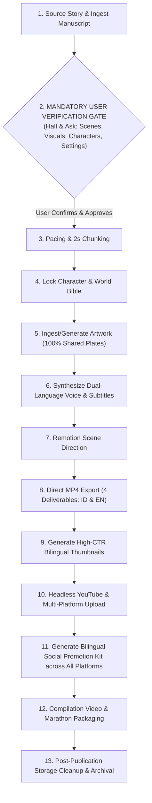

# Storybook & AI Video Storyboard Generator

Transforms open-license children's storybooks and creative folklore concepts into cinematic animated videos with **bilingual editions by default (Bahasa Indonesia & English)** for YouTube (16:9) and TikTok/Shorts/Reels (9:16) using 100% shared visual consistency bibles, neural voiceover, tactile Foley/ASMR sound design, and Remotion video rendering.

## Quick Reference & Prerequisites

| Requirement | Specification | Reference Document |
| :--- | :--- | :--- |
| **Tooling & AI Model Matrix** | Node.js `>=18`, tsx, Remotion, `msedge-tts`, Model Recommendations | [prerequisites.md](./references/prerequisites.md) |
| **Directory Template** | Self-contained story folder, raw files, bibles, exports, `story.json` | [directory-template.md](./references/directory-template.md) |
| **Story Repositories** | SIBI Kemendikbud, Badan Bahasa, StoryWeaver (CC BY 4.0), GDL | [story-sources.md](./references/story-sources.md) |
| **Visual Consistency & Masterboard** | Character Bible, World Bible, 9:16 Poster Sheet, Chained Prompts | [consistency-bible.md](./references/consistency-bible.md) |
| **Cinematography & Motion** | Bang Motion camera laws, multi-plane depth, optional I2V motion | [cinematography.md](./references/cinematography.md) |
| **Audio, Foley & Subtitles** | Azure Neural Voice (`id-ID-GadisNeural` & `en-US-AnaNeural`), Foley/ASMR, kinetic sync | [voiceover-subtitles.md](./references/voiceover-subtitles.md) |
| **Video Rendering** | Remotion CLI render, bilingual 1080p MP4 export (16:9 & 9:16), optional 4K UHD | [remotion-renderer.md](./references/remotion-renderer.md) |
| **Moral of the Story Outro** | Dedicated kid-friendly moral takeaway card, playful pill badge, hero vignette & kinetic read-along | [cinematography.md#moral-scene-direction](./references/cinematography.md#moral-scene-direction) |
| **Duration & Platform Strategy** | <20s Short-only, 20-60s Short-primary, 60-180s Dual, >180s Long-primary (YouTube, TikTok, Reels) | [video-duration-strategy.md](./references/video-duration-strategy.md) |
| **Compilation & Marathon Engine** | Auto-recommendation, thematic curation, ChapterBumper interstitials, >8 min Mid-Roll, YouTube Chapters | [compilation-marathon.md](./references/compilation-marathon.md) |
| **Publishing & Distribution** | YouTube Data API v3, Instagram Reels (via Cloudflare R2), Facebook (Reels & Page Video) | [distribution-upload.md](./references/distribution-upload.md) |
| **Bilingual Social Promotion & Growth** | Single post dual-language hook, carousel blueprint, engagement questions, YouTube Community polls | [social-promotion-playbook.md](./references/social-promotion-playbook.md) |
| **Audit & Publication Catalog** | Standalone GitHub Pages catalog (`docs/index.html`), 53+ multi-platform records, CSV/JSON export | [distribution-upload.md#7-multi-platform-publication-catalog--audit-portal-github-pages](./references/distribution-upload.md#7-multi-platform-publication-catalog--audit-portal-github-pages) |
| **Analytics & Performance Tracking** | Live views, likes, comments, and catalog metrics via YouTube Data & Analytics API | [distribution-upload.md#5-live-performance--view-analytics-npm-run-stats](./references/distribution-upload.md#5-live-performance--view-analytics-npm-run-stats) |
| **Copyright & Verification** | CC BY 4.0 attribution, derivative ownership, YouTube Copyright Match Tool | [copyright-compliance.md](./references/copyright-compliance.md) |
| **Storage Lifecycle & Cleanup** | Reclaim disk space by purging published MP4s and raw PDF pages with 100% reproducibility | [storage-cleanup-policy.md](./references/storage-cleanup-policy.md) |
| **Boundaries & Limitations** | YouTube Quota, Thumbnail Burst Limits, CDP WebSockets, TTS Alignment | [limitations-and-workarounds.md](./references/limitations-and-workarounds.md) |

---

## When to Use

* Producing automated children's storybook videos in **both Bahasa Indonesia and English** from public or open-source literature.
* Creating structured scene-by-scene video storyboards and 9:16 infographic visual masterboards.
* Generating short-form animated educational content for TikTok, IG Reels, or YouTube Shorts.
* Requiring strict visual character and environment consistency across multi-scene narrative videos.
* Synthesizing child-friendly dual-language voiceovers paired with tactile Foley/ASMR sound effects and kinetic subtitles.

### When NOT to Use
* Generating live-action videos, photorealistic talking heads, or 3D character avatars.
* Generic text-to-video prompt workflows that do not require character consistency or storybooks.

---

## Step-by-Step Production Workflow



### 1. Ingest Storyline & Local Duplicate Check
* **Duplicate Detection**: Check if `stories/<book-slug>/story.json` exists locally. If present, prompt user with a decision card (Resume & Edit, New Version `-v2`, or Overwrite) before modifying anything.
* Select a legitimate source from [story-sources.md](./references/story-sources.md).
* Initialize the self-contained project container: `stories/<book-slug>/{raw,bible,assets,exports}`.
* **Bilingual Text Extraction & Moral Formulation (Default)**: Save clean extracted manuscripts for both languages, and formulate a child-friendly closing moral takeaway (headline + spoken advice):
  * `raw/source-manuscript-id.txt` (Bahasa Indonesia narrative + Pesan Moral Cerita)
  * `raw/source-manuscript-en.txt` (English translation + Moral of the Story)
* Scaffold `story.json` with bilingual scene mappings using the template in [directory-template.md](./references/directory-template.md), ensuring the story concludes with a dedicated `"type": "moral"` scene.

### 2. Mandatory User Verification & Clarification Checkpoint (HALT & CONFIRM)
**⛔ HALT EXECUTION GATE — DO NOT AUTONOMOUSLY PROCEED TO ASSET GENERATION**:  
Immediately after fetching the storyline and source manuscript (and **BEFORE** synthesizing any voiceover, extracting/generating illustrations, or rendering video), the agent **MUST STOP and interactively present the Storyboard & Production Verification Brief** in chat.

The agent **MUST explicitly ask the user to clarify, verify, and confirm the following 5 dimensions**:
1. **Scene Breakdown & Bilingual Manuscript (Including Closing Moral Takeaway)**:
   * Scene count, narrative flow, estimated durations, and exact spoken text in both Bahasa Indonesia and English.
   * **Mandatory Closing Moral Scene (`type: "moral"`)**: The brief must specify the child-friendly moral takeaway (headline and spoken outro lesson) that concludes the video.
2. **Illustration Availability & Sourcing Strategy**:
   * Confirm source type: Are authentic open-access PDF/clean plates available (e.g. StoryWeaver, Pratham Books, SIBI Kemendikbud) for automated smart text exclusion & inpainting? Or will source-fidelity AI illustration generation be used?
   * Book layout: Cover orientation (`portrait` vs `landscape`) and page spreads (single pages vs two-page spreads).
3. **Character Details (Character Bible)**:
   * Protagonists, supporting cast, physical traits, cultural garments, species, and hex color palettes.
4. **Settings & Environment (World Bible)**:
   * Setting, biome, era, background palette tones, lighting mood, and proposed art medium (e.g. *Whimsical Watercolor*, *Folk Art Gouache*).
5. **Voiceover, Duration & Format Publishing Strategy**:
   * Voice personas (e.g. `id-ID-GadisNeural`, `en-US-AnaNeural`), pacing/pitch, and background foley cues.
   * **Duration-Based Publication Strategy** (per [video-duration-strategy.md](./references/video-duration-strategy.md)):
     - **Tier 1 (< 20s)**: *Micro-Story / Teaser* $\to$ Recommend **Short-Form Exclusive (9:16 Shorts/Reels/TikTok ONLY)**. Suppress standalone 16:9 landscape upload to protect long-form channel watch time.
     - **Tier 2 (20s – 60s)**: *Snackable Story* $\to$ Recommend **Short-Primary (9:16)**; 16:9 compilation candidate.
     - **Tier 3 (60s – 180s / 1–3 mins)**: *Standard Storybook* $\to$ Recommend **Dual-Format Hybrid (Full 16:9 Long-Form & Full 9:16 Shorts)**.
     - **Tier 4 (> 180s / > 3 mins)**: *Extended Bedtime Tale* $\to$ Recommend **Long-Primary (16:9 Master Video)** + 30–45s Vertical Teaser hook for Shorts/Reels/TikTok.

> **File-First & Interactive Rule**: Always save the complete proposal to `stories/<book-slug>/raw/user-review-card.md` first, then output the structured verification summary directly in chat. **The agent MUST wait for the user to confirm, adjust, or approve before proceeding to Step 3.**

### 3. Apply 2-Second Rhythmic Pacing
* Target **6.0 to 8.5 seconds** per scene plate.
* Chunk text into **2 to 3 word breath groups** (~1.8s to 2.4s per phrase). Punctuation marks (`,`, `.`, `!`, `?`) force immediate phrase boundaries in both languages.

### 4. Lock Consistency Bibles
* Define the **Character Bible** (immutable physical traits, cultural attire, color palette).
* Save to `bible/character-bible.json` and embed in `story.json`.
* Define the **World Bible** (biome, lighting mood, color hex codes) in `bible/world-bible.json`.
* Select the art medium preset (e.g. *Whimsical Fairytale Watercolor* or *Priya Kuriyan Folk Art Gouache*).
* See detailed schemas and templates in [consistency-bible.md](./references/consistency-bible.md).

### 5. Ingest Artwork (Priority Ladder — 100% Shared Across Languages)
* **Zero Language Redundancy**: All visual plates (`assets/scene_XX.png`, `cover.png`) are text-free and language-agnostic; they are **100% shared between Indonesian and English video deliverables**.
* **Priority 1 (Authentic Source PDF & Clean Plates Extraction)**:
  * Check open-access repositories (Internet Archive Pratham collection, StoryWeaver, SIBI Kemendikbud, Arvind Gupta Toys) to download the authentic storybook PDF (`raw/source-book.pdf`).
  * Extract pages using native Swift/PDFKit (`swift scripts/extract-pdf-pages.swift raw/source-book.pdf raw/pages/`).
  * Run **Automated Smart Text Exclusion & Inpainting** (`scripts/smart-text-inpaint.swift` using Apple Vision OCR) to remove typography, author credits, and page numbers, yielding 100% pure artist illustration plates.
  * Preserves 100% authentic artist vision, incurs zero AI generation quota, and guarantees zero character drift.
* **Priority 2 (Source-Fidelity AI Generation)**: When clean authentic artwork or open-access PDFs are unavailable (e.g. text-only folklore manuscripts), generate fresh AI illustrations strictly adhering to the character physical traits, attire, species, and environmental setting described in the source manuscript.
* **Never Render Incomplete/Placeholder Deliverables Unasked**: Do not output final videos with placeholder SVGs or incomplete illustration scenes unless the user explicitly requests a draft preview. All scenes must contain complete, authentic artwork before initiating full production rendering.
* **3D Cover**: 2.5s opener with embossed gold gilded edges and author credit (`assets/cover.png`). Cover portrait books should set `book.coverOrientation = "portrait"`.
* Never reuse low-res scans with baked-in typography. Append negative constraints (`--no text, no watermark, no typography`). Details in [consistency-bible.md](./references/consistency-bible.md).

### ⚠️ Mandatory Quota & Limitation Confirmation Protocol

Whenever ANY API quota limit, rate limit, burst velocity cap, or platform boundary is encountered at ANY stage of production (e.g., Image Generation `429 / RESOURCE_EXHAUSTED`, YouTube Upload Limit `400 uploadLimitExceeded` / `403 quotaExceeded`, YouTube Thumbnail burst rate-limit, TTS throttling):

1. **STRICT PROHIBITION: Zero Autonomous Fallbacks**:
   * The agent **MUST NEVER** autonomously choose an unasked workaround (such as generating placeholder cards, rendering draft videos with missing scenes, skipping deliverables, or deferring uploads silently).
   * The agent **MUST IMMEDIATELY HALT** that execution lane.
   * Do NOT render final video deliverables with placeholder boxes or missing artwork unless the user explicitly requested a draft preview.

2. **SURFACE A FORMAL DECISION CARD**:
   * Present an official Decision Card to the user with verified error signatures, exact reset cooldown window, and options ordered by risk:
     * **Option 1 (Recommended — Wait & Auto-Resume / Schedule)**: Pause pipeline lane, record cooldown reset timestamp, and resume when the quota opens.
       - *Risk*: Minimal. *Blast Radius*: Single task paused. *Cost*: Free. *Reversibility*: 100%. *Business Impact*: Full quality preserved, zero incomplete deliverables.
     * **Option 2 (Alternative Key / Source Ingestion)**: Ingest authentic open-source PDF/plates or provide alternative API credentials.
       - *Risk*: Low. *Blast Radius*: None. *Cost*: Zero/User-supplied. *Reversibility*: High.
     * **Option 3 (User-Requested Progressive Draft Preview)**: Only if explicitly approved by user: generate temporary storyboard placeholders to preview audio pacing, subtitles, and scene duration before final plates arrive.
       - *Risk*: High (incomplete visual output). *Blast Radius*: Video exports contain placeholders. *Reversibility*: Fast (<60s swap).

3. **AWAIT USER CONFIRMATION**:
   * Do not assume, guess, or execute any fallback without the user's explicit confirmation. Await user selection before proceeding.

### 6. Synthesize Dual-Language Voice, Subtitles & Foley (Default)
* **Pure Child Voice Rule (No Adult Male Formants)**:
  * **Never use `id-ID-ArdiNeural` for child narrators or child characters**. `ArdiNeural` retains adult male chest resonance (*formants*) even when pitch-shifted.
  * In Indonesian (`id-ID`), use `id-ID-GadisNeural` for all child personas with **dual-cadence prosody**:
    * **Child Narrator (Zayn Storyteller Host)**: `id-ID-GadisNeural` (`pitch: +18%`, `speed: +10%`). Lively, attractive, joyful, presentation host cadence.
    * **Child Protagonist (Aku / Main Character)**: `id-ID-GadisNeural` (`pitch: +32%`, `speed: +4%`). Sweet, cute, innocent child storytelling cadence.
    * **Child Girl Supporting**: `id-ID-GadisNeural` (`pitch: +34%`, `speed: +5%`).
    * **Child Boy Supporting**: `id-ID-GadisNeural` (`pitch: +20%`, `speed: +6%`).
    * **Adult Roles**: Use `id-ID-GadisNeural` (`pitch: -6Hz`, `speed: -8%`) for Mother, `id-ID-ArdiNeural` (`pitch: -2Hz`, `speed: -2%`) for Father, and `id-ID-ArdiNeural` (`pitch: -8Hz`, `speed: -10%`) for Grandparent / Elder.
  * **Comedic Interjections & Punctuation**: Embed lively expressive interjections in manuscripts (*"Waaah!"*, *"Waduh!"*, *"Aduh!"*, *"Horeee!"*, *"Hihihi!"*, *"Plop!"*, *"Guk guk!"*, *"Hosh... hosh..."*) and exclamation marks `!` to force the neural engine to modulate pitch with joyful comedic acting.
  * Saved to `assets/id/scene_XX.mp3` & `assets/id/scene_XX_words.json`.
* **English (`en-US` / `en-GB`) Track**:
  * Narrator: `en-US-AnaNeural` (`pitch: +15%`, `speed: +8%`).
  * Protagonist: `en-US-AnaNeural` (`pitch: +28%`, `speed: +4%`).
  * Saved to `assets/en/scene_XX.mp3` & `assets/en/scene_XX_words.json`.
* **Punctuation (*Tanda Baca*) Restoration**: Azure `WordBoundary` strips punctuation; run `attachPunctuation()` to re-align original punctuation (`?`, `!`, `,`, `.`, `...`, hyphens) to timing tokens in both languages.
* **Full-Context Kinetic Subtitles (Zero-Cut Policy)**:
  * **Never Chop Context**: Do not slice sentences into arbitrary 4-word snippets that vanish mid-sentence. Display the complete sentence / thought context of the scene together.
  * **Natural Sentence Boundaries**: For longer narratives, group words by natural punctuation marks (`.`, `!`, `?`, `...`), keeping each complete sentence intact on screen.
  * **Voiceover Alignment**: Active spoken words animate with a spring bounce and glow in the speaker's accent color (`#FDE047`, `#38BDF8`). Already spoken words stay visible in crisp solid white (`#FFFFFF`), while upcoming words remain readable in soft translucent white (`rgba(255,255,255,0.6)`).
* **Multi-Speaker Color Tagging**: Assign distinct color accents and avatar tags per persona (Teacher `#38BDF8`, Child `#FDE047`, Narrator `#34D399`, King `#F59E0B`).
* **Multi-Track Audio Engineering (Voiceover + BGM + Action Foley SFX)**:
  * **Track 1 — Foreground Neural Voiceover**: Child storyteller speech at volume `1.00`.
  * **Track 2 — Continuous Acoustic Background Music (BGM)**: Gentle, warm marimba/glockenspiel storybook soundtrack (`assets/audio/bgm_whimsical_story.m4a`) looping seamlessly at volume `0.14` to eliminate awkward dead silence between spoken phrases.
  * **Track 3 — Synchronized Action Foley SFX**: Tactile cartoon sound effects (`assets/sfx/sfx_XX.m4a`) triggered per-scene with millisecond delay timing (`sfxDelaySeconds`, volume `0.65`):
    * Scene action examples: scissors snipping, cooking pots bubbling, wood saw slicing, tiger roaring with shockwave rumble, comic *boing-pop* when hair falls off, cartoon galloping footsteps, crystal head shine *ping*, and celebratory chimes.
  * Details in [voiceover-subtitles.md](./references/voiceover-subtitles.md).

### 7. Configure Remotion Scene Direction
* Enforce Bang Motion camera laws: scale `≥ 1.08x`, continuous camera breathing, and alternating motions (`slow_zoom_in`, `pan_right`, `tilt_up`).
* **Preserve Narrative Scene Continuity (No Artificial Chopping)**: Do not artificially split a single coherent book page or unified illustration into fragmented micro-scenes with abrupt camera cuts. Keep the scene context unified and let the narrative and audio flow smoothly.
* **Zero-Crop Vertical Canvas (9:16 Shorts/Reels)**: Use Ambient Pillarbox Canvas (full-bleed blurred background + floating 16:9 centerpiece plate + subtitles below artwork). Never use raw `objectFit: cover` which cuts off >60% of horizontal action.
* **3D Cover Presence (Zero Empty Space)**:
  * Scale book cover to fill **65% to 75%** of the frame (landscape: `height: 760px, width: 560–1160px`; vertical: `height: 1180px, width: 860–1000px`).
  * Embellish with animated golden stardust particles, gilded 3D spine creases, and giant readable title typography (`fontSize: 46px–56px`) so no awkward dead space remains.
* **Dedicated Kid-Friendly Moral Outro Scene (`MoralScene.tsx`)**:
  * Every video must conclude with a dedicated, uplifting closing scene (`type: "moral"`) designed for young children (3–8 years):
    * **Playful Badge & Header**: Floating animated pill badge (`✨ PESAN MORAL CERITA ✨` / `✨ MORAL OF THE STORY ✨`) with spring entrance and glowing golden border.
    * **Hero Avatar Vignette**: Circular illustration frame with golden sticker border (`border: '5px solid #F59E0B'`) displaying the happy protagonist alongside a floating `💡` insight badge.
    * **Child-Friendly Card Layout**: Soft rounded cloud-white card (`background: linear-gradient(180deg, #FFFFFF, #FEF9C3)`, `borderRadius: 36px–44px`, `boxShadow: 0 24px 70px rgba(0,0,0,0.45)`).
    * **Kinetic Read-Along Box**: Dashed warm amber box with real-time karaoke word bouncing & highlighting so children can read along phonetically with the neural voiceover.
    * **Floating Sparkles & Stars**: Gentle floating particles (`⭐`, `✨`, `🌟`, `💖`, `🌈`) drifting with smooth sine-wave animation.
    * **Encouraging Outro Note**: Sweet parting message (`💖 Terima kasih sudah menonton! Sampai jumpa di dongeng seru berikutnya! ✨` / `💖 Thank you for watching! See you in the next adventure! ✨`).
* **Next Video Recommendation & Subscribe Outro Scene (`OutroScene.tsx`)**:
  * An 8–10 second dynamic ending scene (`type: "outro"`) engineered for cross-story discovery and channel growth:
    * **Dynamic & Universal Standard**: Never hardcode specific story titles into outro voiceovers or default labels so that the outro template is 100% reusable across any current or future storybook:
      * **Universal Voiceover Narration**:
        * ID: *"Wah, seru sekali ya ceritanya! Jangan lupa klik video di sebelah sini untuk menonton dongeng seru lainnya, dan klik tombol Subscribe agar kita bisa terus berpetualang bersama! Sampai jumpa di cerita berikutnya! Dadah!"*
        * EN: *"Did you enjoy the story? Click the video on your screen to watch another fun adventure, and don't forget to hit Subscribe so we can keep reading together! See you in the next story! Bye-bye!"*
      * **Dynamic Preview Box**: 16:9 frame displaying dynamic recommendation title (`"Dongeng Seru Berikutnya!"` / `"Next Exciting Adventure!"`), subtitle (`"Klik untuk Menonton Cerita Lengkap"`), and "Play ▶" button. **Coordinates are pixel-matched to YouTube's End Screen 16:9 interactive element**, ensuring YouTube Studio's "Best for Viewer" interactive card snaps seamlessly over the frame while remaining visually compelling on Shorts, TikTok, and Reels!
      * **Dynamic Channel Subscribe Card**: Pulsing avatar paired with dynamic channel handle (`@ZaynAdyanRamadhan`), tagline (`"Dongeng Cerita Baru Tiap Minggu!"`), and bold red `SUBSCRIBE 🔔` call-to-action button, aligning with YouTube's Subscribe End Screen element.
      * **Full-Context Kinetic Subtitles**: Syncs spoken outro voiceover with real-time word bouncing and phonetic color highlights.
* **Responsive Subtitle Positioning & Safe Zones**:
  * **Landscape 16:9**: Positioned at `bottom: "64px"`, max-width `84%`, rounded glassmorphic card (`borderRadius: "20px"`), font size `32px`.
  * **Vertical 9:16**: Positioned at `bottom: "260px"` (well above YouTube Shorts / TikTok bottom UI overlays of 0–220px, and comfortably below the centerpiece illustration card), font size `27px`. See [cinematography.md](./references/cinematography.md).

### 8. Export Multi-Format MP4 Videos (4 Deliverables by Default)
* Execute Remotion headless rendering CLI commands to export all 4 deliverables (ID 16:9, ID 9:16, EN 16:9, EN 9:16):
  ```bash
  # Render all 4 bilingual video deliverables by default (1080p Full HD)
  npx tsx scripts/render-book.ts --book <book-slug> --lang all --format all

  # Render single language only if requested
  npx tsx scripts/render-book.ts --book <book-slug> --lang id --format all
  npx tsx scripts/render-book.ts --book <book-slug> --lang en --format all

  # Optional 4K UHD Master (Forces YouTube high-bitrate VP9/AV1 codec allocation)
  npx tsx scripts/render-book.ts --book <book-slug> --format all --resolution 4k
  ```
* Deliverables:
  * `stories/<book-slug>/exports/id/<book-slug>-16x9.mp4` & `-9x16.mp4`
  * `stories/<book-slug>/exports/en/<book-slug>-16x9.mp4` & `-9x16.mp4`
* Details in [remotion-renderer.md](./references/remotion-renderer.md).

### 9. Generate High-CTR Bilingual Thumbnails (Edge-to-Edge & Zero Dead Space)
* Generate high-CTR 1920x1080 thumbnails for both languages before publishing. YouTube thumbnail CTR determines algorithmic reach.
* **Edge-to-Edge Screen Fill Rule**:
  * >75% of YouTube watch time originates on mobile devices where thumbnails are displayed at ~140px wide. Centered tiny elements or vast empty borders kill CTR.
  * The hero asset and bold typography must occupy **≥85% of total thumbnail canvas area**.
* **Format 1 — Popular Comic Action Hook (`thumbnail-popular.png`)**:
  * **Giant 2-Line Headline**: Line 1 `fontSize: 90px`, Line 2 `fontSize: 116px` with thick black stroke (`-webkit-text-stroke: 6px–7px #000`), 3D amber extrusion shadow (`0 10px 0 #B45309`), and tight line height (`0.92`) to eliminate vertical dead space.
  * **Massive Hero Artwork Frame**: Expanded to `860px × 720px` (was 780×640), filling the entire right half of the frame with a dynamic `rotate(2.2deg)` angle, thick `14px solid #FFFFFF` sticker border, and 3D yellow ambient drop shadow (`0 40px 105px rgba(0,0,0,0.95)`).
  * **Curiosity Gap Hook Sticker**: `fontSize: 36px` on punchy cyan badge (`#38BDF8`) with dark 3D bevel.
  * **Narrow Edge Padding**: Reduced to `48px` horizontally to utilize the full widescreen canvas.
  * **Safe-Zone Compliant**: Bottom-right corner reserved for YouTube's video duration timestamp pill.
* **Format 2 — Niche Whimsical Bedtime Storybook (`thumbnail-bedtime.png`)**:
  * Expanded storybook frame (`860px × 680px`) with ornate golden rim (`border: 8px solid rgba(251, 191, 36, 0.95)`).
  * Gold embossed typography (`fontSize: 84px`), moonlight pill (`🌙 DONGENG SEBELUM TIDUR` / `🌙 BEDTIME READ-ALOUD`), and gentle bedtime subtitle.
* **Format 3 — Vertical 9:16 Shorts & Reels Cover (`thumbnail-vertical.png`)**:
  * Centerpiece hero card enlarged to `1000px × 980px` (was 960×800) with thick 14px sticker border and reaction sticker.
  * Stacked headline scaled to `90px` and `114px`, filling the vertical canvas without dead space.
  * High-contrast title typography + curiosity gap hook sticker, safe-zone compliant (top 110px and bottom 190px clear for native player UI).
* **Format 4 — Fanned Compilation Marathon Cover (`StorybookCompilationThumbnail`)**:
  * 4 fanned storybook covers scaled up with hero cover at `620px × 440px` (was 450×320) and supporting covers at 570px, 540px, and 520px, filling ≥80% of the right column with zero dead margins.
* **Automated Remotion Still Rendering**:
  ```bash
  # Render all thumbnail variants (Landscape & Vertical Shorts, ID & EN):
  npm run thumbnail -- --book <book-slug> --lang all --variant all

  # Audit existing thumbnails (exit 0 = all valid, exit 1 = failures):
  npm run thumbnail -- --book <book-slug> --verify

  # Audit all stories in the repo:
  npm run thumbnail:verify

  # Auto-repair missing or invalid thumbnails across all stories:
  npm run thumbnail:repair
  ```
* **Mandatory 4-Thumbnail Requirement** — every story needs all 4 types **per language** before publish:

  | File | Dimensions | Platforms |
  |---|---|---|
  | `thumbnail-popular.png` | 1920×1080 | YouTube (primary), Facebook Video |
  | `thumbnail-bedtime.png` | 1920×1080 | YouTube Bedtime/Niche playlists |
  | `thumbnail.png` | 1920×1080 | Default fallback, FB Link Card, SEO OpenGraph |
  | `thumbnail-vertical.png` | 1080×1920 | YouTube Shorts, Instagram Reels, FB Reels, TikTok |

  → Full safe-zone specs and platform matrix: [thumbnail-platform-spec.md](./references/thumbnail-platform-spec.md)

* Deliverables:
  * `stories/<book-slug>/exports/id/thumbnail-popular.png`, `thumbnail-bedtime.png`, `thumbnail.png`, & `thumbnail-vertical.png`
  * `stories/<book-slug>/exports/en/thumbnail-popular.png`, `thumbnail-bedtime.png`, `thumbnail.png`, & `thumbnail-vertical.png`
* **Auto-Verification Gate in `publish:all`**: `scripts/publish-all.ts` runs `verifyStoryThumbnails()` before every platform upload. Missing or wrong-dimension thumbnails are auto-rendered via Remotion. Run `npm run thumbnail:verify` before the first publish of any new story.
* **Shorts Mobile Feed Reality**: YouTube mobile Shorts feed auto-picks a video frame from 0.0s–1.0s. `thumbnail-vertical.png` attaches to YouTube API for desktop/playlists and serves as the curated cover for Instagram Reels and Facebook Reels. Instagram cover **cannot be updated post-publish** — ensure the thumbnail is correct before upload.

### 10. Multi-Platform Idempotent Publishing & Duplicate Prevention
* **YouTube Dual-Format Intentional Strategy & Shorts Duration Policy**:
  * **Intentional Dual-Format Policy**: Having both a 16:9 widescreen master video (in YouTube "Videos" tab) and a 9:16 vertical video (in YouTube "Shorts" tab) is fully intentional and supported for dual-feed algorithmic discovery.
  * **Strict <=180s Shorts Limit Guardrail**: YouTube strictly limits Shorts to 180s (3m). Any vertical video >180s is automatically rejected by YouTube as a Short and demoted into the channel's standard "Videos" tab with letterbox black bars, creating an undesirable horizontal letterboxed duplicate. The upload engine automatically allows dual-format for <=180s (Tier 2 & Tier 3), and suppresses vertical only when duration >180s (Tier 4).
  * **Platform Division of Labor**:
    * **YouTube Videos Tab**: 16:9 Landscape Widescreen Master Storybooks & Compilations.
    * **YouTube Shorts Tab**: 9:16 Vertical Shorts (strictly $\le 180$ seconds).
    * **Instagram & Facebook Reels**: 9:16 Vertical Video (with R2-protected custom cover).
    * **TikTok**: 9:16 Vertical Video / Teasers.
* **Instagram Reels Cloudflare R2 Cover Lifecycle**:
  * The temporary cover file staged on Cloudflare R2 MUST NOT be cleaned up during transcoding polling; `coverCleanup()` runs strictly in the `finally` block **after** `POST /media_publish` returns success.
* **Automated Duration-Based Format Routing (Channel Metric Protection)**:
  * Inspects story total duration before publishing to enforce platform best practices ([video-duration-strategy.md](./references/video-duration-strategy.md)):
    * **Tier 1 (< 20s)**: *Micro-Story / Teaser* $\to$ Automatically sets `--format vertical` (Shorts/TikTok/Reels ONLY). Suppresses 16:9 landscape upload to prevent poor viewer retention and algorithmic suppression on horizontal YouTube channels (override with `--allow-short-landscape`).
    * **Tier 2 (20s – 60s)**: *Snackable Story* $\to$ Recommends Shorts/TikTok/Reels as primary; 16:9 optional or compilation candidate.
    * **Tier 3 (60s – 180s / 1–3 mins)**: *Standard Storybook* $\to$ Publishes **Dual-Format (Full 16:9 Widescreen & Full 9:16 Shorts)**.
    * **Tier 4 (> 180s / > 3 mins)**: *Extended Bedtime Tale* $\to$ Publishes 16:9 Long-Form Hero; extracts/renders 30–45s Teaser Hook for Shorts/Reels/TikTok.
* **Pre-Publishing Deduplication Protocol (Local & Cross-Platform)**:
  * Before publishing any video (YouTube, TikTok, Reels), the pipeline executes a 2-stage deduplication check:
    1. **Local Manifest Probe**: Checks `story.json.publications[platform]` and `story.json.exports` for existing remote video IDs.
    2. **Remote API Live Verification**:
       * **YouTube**: Calls `youtube.videos.list` and `youtube.search.list(forMine: true)` to verify whether the video is already active.
       * **Meta (Instagram & Facebook)**: Calls `GET /{instagramUserId}/media` and `GET /{facebookPageId}/videos` to match canonical titles against live captions.
         * *Critical Instagram Constraint*: Meta Graph API **does not support remote deletion** of published media (`Unsupported delete request` code 100/33) nor PATCH updates to covers. Once published, older Reels cannot be deleted via API. Therefore, pre-upload live detection is mandatory: any video already live on Instagram/Facebook is **automatically skipped** to guarantee zero duplicate reels.
  * **Safe Idempotency Handling**:
    * **Default (Safe Skip)**: If the video is already live on the platform, the upload is skipped with a `🛑 DUPLICATE DETECTED` notice to prevent duplicate content and wasted API quota.
    * **`--resync-all` / `--update-metadata`**: Updates remote title, description, tags, chapters, and custom thumbnails (16:9 for landscape, 9:16 for shorts) across all published videos without re-uploading video files.
    * **`--force` / `--replace`**: Replaces the video (for YouTube, deletes old remote video first; for Meta, warns user and proceeds with fresh post).
* **Automated Publishing CLI**:
  ```bash
  # Publish with automated duration routing (safely uploads to optimal formats):
  npm run upload -- --book <book-slug> --lang all --privacy unlisted

  # Explicit format control:
  npm run upload -- --book <book-slug> --format vertical  # Shorts/TikTok/Reels only (<20s or quick story)
  npm run upload -- --book <book-slug> --format landscape # 16:9 Widescreen only

  # Full resync of title, description, chapters & custom thumbnails across all videos & shorts:
  npm run upload -- --book <book-slug> --lang all --resync-all

  # Force replace video (safely deletes old remote video first before uploading):
  npm run upload -- --book <book-slug> --lang all --force

  # Update custom high-CTR thumbnails only on existing published YouTube videos:
  npx tsx scripts/upload-youtube.ts --book <book-slug> --lang all --update-thumbnails

  # Audit all channel videos, aspect ratios, durations & check for duplicate titles:
  npx tsx scripts/list-channel-videos.ts

  # Channel remedy engine (batch-sync high-CTR thumbnails & purge vertical duplicates):
  npx tsx scripts/remedy-youtube-duplicates-and-thumbnails.ts --dry-run
  npx tsx scripts/remedy-youtube-duplicates-and-thumbnails.ts

  # Monitor real-time views, likes, comments & channel performance:
  npm run stats

  # --- MULTI-PLATFORM UNIFIED PUBLISHER (YOUTUBE, INSTAGRAM & FACEBOOK) ---
  # One-shot automated distribution across all platforms:
  npm run publish:all -- --book <book-slug>
  npm run publish:all -- --book <book-slug> --lang all
  npm run publish:all -- --book <book-slug> --dry-run

  # --- META PUBLISHING (INSTAGRAM REELS & FACEBOOK) ---
  # Verify Meta Page, Instagram Account & Publishing Quota:
  npm run test:meta

  # Upload to Instagram Reels (9:16 Vertical via Cloudflare R2 Edge CDN buffer):
  npm run upload:meta -- --book <book-slug> --platform instagram

  # Upload to Facebook Reels (9:16 Vertical direct multipart):
  npm run upload:meta -- --book <book-slug> --platform facebook --format vertical

  # Upload to Facebook Normal Page Video / Watch (16:9 Landscape + Custom Thumbnail):
  npm run upload:meta -- --book <book-slug> --platform facebook --format landscape

  # Upload to BOTH Instagram Reels and Facebook Page:
  npm run upload:meta -- --book <book-slug> --platform both

  # Monitor real-time Meta performance (Facebook & Instagram views, likes, comments):
  npm run stats:meta
  ```
* Saves returned live video IDs, URLs, and timestamps into `story.json.publications[platform]`. Details in [distribution-upload.md](./references/distribution-upload.md).
* **Cloudflare R2 Temporary Edge Buffer Lifecycle**:
  * For Instagram Reels, the video is staged on Cloudflare R2 (`zayn-storybook` bucket, $0 egress).
  * As soon as Meta confirms container transcoding is `READY`, the script **automatically deletes the R2 video object** (`DeleteObjectCommand`), keeping cloud storage at **0 MB** permanently.
* **Live View Analytics & Performance Monitoring**:
  * Run `npm run stats` anytime to query YouTube Data API v3 and generate an instant consolidated performance matrix of all published storybooks across languages and formats (real-time views, likes, comments, privacy status, and channel totals).
  * Deeper audience retention curves, traffic sources, and demographics can be queried via the YouTube Analytics API v2 (`youtubeAnalytics.reports.query`) with the `yt-analytics.readonly` OAuth scope. Details in [distribution-upload.md](./references/distribution-upload.md).
* **Publishing Quota Cap & Velocity Limitation Handling**:
  * If YouTube returns `400 Bad Request: The user has exceeded the number of videos they may upload` (daily upload limit) or `403 quotaExceeded`:
    1. Trap the error gracefully. Tag pending exports in `story.json.publications.youtube` as `"status": "daily_limit_reached"`.
    2. Halt further uploads immediately to prevent token churn.
    3. Present an official Decision Card to the user:
       - **Option 1 (Recommended — Auto-Schedule / Resume on Rolling Reset)**: Keep exports ready and run upload once the rolling 24h reset opens (~12:17 WIB / 05:17 UTC).
       - **Option 2 (Switch Channel / OAuth Profile)**: Authenticate another channel profile if managing multiple channels.
       - **Option 3 (Manual Upload via YouTube Studio)**: Use local MP4 files in `exports/` paired with `exports/youtube-upload-metadata.md`.
    4. Await user confirmation before attempting retry.
* **Meta & Instagram Graph API Safety Doctrine (Anti-Spam & Algorithmic Protection)**:
  * **Strict Prohibition of Rapid / Burst Uploads**:
    * **NEVER** publish multiple Instagram Reels or Carousel posts in rapid succession (e.g., within seconds or minutes).
    * Instagram enforces hyper-aggressive automated bot / inauthentic activity filters, especially on young accounts (<30 days old or <1,000 followers).
    * Rapid publishing (>3 videos within 15 minutes) triggers Meta's anti-spam heuristics: Meta automatically unlinks the Page's `instagram_business_account` node, masks API endpoints with `GraphMethodException: Object with ID '...' does not exist (code 100, error_subcode 33)`, and issues an algorithmic temporary account suspension (*"We suspended your account... Inauthentic automated activity"*).
  * **Enforced Cooldown Architecture**:
    * Any automated batch script (`scripts/publish-instagram-reels.ts`) MUST enforce a mandatory cooldown (minimum 30–60 minutes between consecutive live uploads).
    * **Primary Cadence**: Strictly prefer single-video daily releases scheduled through the GitHub Actions workflow (`.github/workflows/daily-broadcast.yml`) at the prime bedtime family slot (19:00 WIB / 12:00 UTC).
  * **Account Suspension Recovery & Re-linking Protocol**:
    1. **Immediate Appeal**: Open the Instagram mobile app, tap **"Disagree with decision"**, and complete SMS OTP, email verification, and video selfie.
    2. **Appeal Statement**: State that uploads were made via registered Meta Developer App using official Meta Graph API endpoints during initial setup of a family-friendly educational children's storybook channel (`@zayn.storybook`).
    3. **Re-link After Restoration**: Open Instagram App ➔ **Edit Profile** ➔ **Public Business Information** ➔ **Page** ➔ Re-select **Zayn Storybook** Facebook Page.
    4. **Generate Fresh Token**: Visit [Meta Graph API Explorer](https://developers.facebook.com/tools/explorer/) and ensure both Page and Instagram account are checked in the permission modal.

### 11. Multi-Platform Bilingual Social Promotion & Audience Growth Engine
* **Playful, Cheerful & Kid-Friendly Voice Doctrine**:
  * **Strict Anti-Formal Standard**: Copywriting MUST NEVER sound stiff, corporate, or academic.
  * **Persona**: Warm, enthusiastic, cheerful storyteller friend (*"Kak Zayn"* vibe) speaking warmly to kids and parents.
  * **Joyful Elements**: Weave in playful interjections (*"Horeee!"*, *"Yeeay!"*, *"Waaah!"*, *"PLOP!"*, *"Hihihi!"*), vibrant emojis (🎈, 🦄, 🌈, 🍭, 🚀, 🐱, 🦁, 🍌, 🌙, ✨, 🧸), and cozy bedtime prompts (*"Tarik selimut hangatmu & peluk bonekamu!"*).
* **The "Single Post, Dual Language" Strategy**: To attract new viewers, spark parent conversations, and capture both domestic Indonesian and global English discovery, every published video MUST generate a structured bilingual promotion package ([social-promotion-playbook.md](./references/social-promotion-playbook.md)):
  * **Double Hook & Engagement Spark**:
    * 🇮🇩 Indonesian cheerful hook + toddler/parenting humor.
    * 🇺🇸 English translation hook for diaspora and ESL families.
    * 💡 Moral of the story sweet takeaway quote.
    * 💬 **Interactive Question for Comments**: Relatable prompt asking parents about their child's funny bedtime excuses or silly habits to trigger algorithm-boosting comment velocity.
    * 💾 **"Save for Bedtime" CTA**: Maximizes bookmark/save count (the #1 ranking signal on Instagram & TikTok).
* **Multi-Platform Deployment Package (`exports/social-promotion-posts.md`)**:
  * **Instagram Feed Carousel (5–7 Slides)**: Cover + Story Stills + Moral Card + YouTube CTA (Published automatically via Meta Graph API).
  * **Facebook Page Feed Post**: High-CTR thumbnail (`thumbnail-popular.png`) + full bilingual story overview + parenting community discussion question (Published automatically via Meta Graph API).
  * **YouTube Community Tab (SKIPPED FROM AUTOMATED API)**: Google YouTube Data API v3 has no Community Tab endpoint. Automated pipelines skip this step cleanly and preserve the formatted text for optional manual posting via YouTube Studio.
  * **TikTok & Reels**: Snappy curiosity teaser (<150 chars).
* **Automated Generation & Publishing CLI**:
  ```bash
  # Generate bilingual social promotion copy kit:
  npm run promo:social -- <book-slug>

  # Publish promotional post to Facebook Page (via Meta Graph API):
  npm run promo:launch -- --book <book-slug>

  # Publish promotional photo or multi-slide carousel to Instagram Feed (via Meta Graph API + Cloudflare R2):
  npm run promo:instagram -- --book <book-slug>            # Single Photo
  npm run promo:instagram -- --book <book-slug> --carousel # Multi-Slide Story Carousel

  # Master one-shot pipeline (Videos + Meta Reels + Facebook Page Post + Instagram Carousel):
  npm run publish:all -- --book <book-slug>
  ```
  *(Note: `npm run publish:all` automatically publishes the video deliverables, then publishes the promotional post to Facebook Page and Instagram Feed, while cleanly skipping YouTube Community Tab without halting).*

### 12. Compilation Video & Marathon Packaging (Auto-Recommendation & Retention Architecture)
* **The Long-Form Monetization Engine**: Individual storybooks (1–3 mins) excel for short-form reach, but compilations (10–30+ mins) unlock **YouTube Mid-Roll Ads (>8 mins)** and serve parent viewing behavior (*"Set-and-Forget"* screen time for bedtime, playtime, and car rides).
* **Auto-Recommendation Engine**:
  * Evaluates local catalog across `stories/`.
  * Triggers recommendation when $\ge 3$ stories or $\ge 8.0$ minutes total duration are available.
  * Recommends themed packages: *Bedtime Stories Marathon*, *Funny Animals & Wit*, *Character & Moral Values*.
  * Inspect recommendations anytime:
    ```bash
    npm run compilation:recommend
    ```
* **Retention Sequencing & Interstitials**:
  * **The Anchor Sequence**: Story 1 (High-energy Hook) $\to$ Story 2 (Momentum) $\to$ Story 3 (Emotional Core) $\to$ Story 4 (Calming Finale).
  * **Intermediate Outro Suppression**: Stories 1 to $N-1$ suppress their individual subscribe outro callout to prevent premature viewer drop-off.
  * **Chapter Bumper (`ChapterBumper.tsx`)**: 4.0s (120 frames) animated transition card between stories with 3D floating cover preview, chapter pill badge (`✨ CERITA SELANJUTNYA • BABAK X DARI Y ✨`), and progress bar.
  * **Master Outro**: The final story plays the complete closing outro with moral advice and channel subscribe invitation.
* **Automated Bilingual YouTube Chapters & Metadata**:
  * Computes exact timestamps and writes copy-paste ready description & chapters to `exports/compilations/kompilasi-<theme>-<lang>-metadata.txt` for both Indonesian and English editions.
* **Distinct Bilingual Compilation Thumbnail Engine**:
  * Renders dedicated 16:9 marathon thumbnail (`StorybookCompilationThumbnail`, `scripts/render-compilation-thumbnail.ts`) featuring 3–4 fanned 3D storybook covers, bold gradient typography, language-specific hooks, and marathon duration badge.
  * Command: `npm run compilation:thumbnail -- --theme <theme> --lang all`
* **Multi-Platform Bilingual Publication (Facebook Watch & YouTube)**:
  * **Facebook Watch**: `npx tsx scripts/upload-meta.ts --compilation <theme> --lang <id|en>` via Cloudflare R2 edge ingestion with custom thumbnail poster.
  * **YouTube Public**: `npx tsx scripts/upload-youtube.ts --compilation <theme> --lang <id|en|all> --privacy public` with auto-detected YouTube Chapters and custom compilation thumbnail.
* **Compilation Commands**:
  ```bash
  # Check auto-recommendations across catalog:
  npm run compilation:recommend

  # Dry-run timeline and generate YouTube Chapters for both languages:
  npm run compilation:render -- --theme bedtime --lang all --dry-run

  # Render Dual-Language Bedtime Marathon (ID & EN 16:9 Landscape):
  npm run compilation:render -- --theme bedtime --lang all

  # Render single language edition:
  npm run compilation:render -- --theme bedtime --lang id
  npm run compilation:render -- --theme bedtime --lang en

  # Custom book sequence:
  npm run compilation:render -- --books gara-gara-kucing,jas-hujan-merah,raja-gemuk-anjing-kurus --lang all

  # Render distinct high-CTR compilation thumbnails (both languages):
  npm run compilation:thumbnail -- --theme bedtime --lang all

  # Render high-resolution standalone chapter preview thumbnails (ID & EN):
  npm run compilation:chapters -- --theme bedtime --lang all

  # Publish compilation to Facebook Watch:
  npx tsx scripts/upload-meta.ts --compilation bedtime --lang id
  npx tsx scripts/upload-meta.ts --compilation bedtime --lang en

  # Publish compilation directly to YouTube Public:
  npx tsx scripts/upload-youtube.ts --compilation bedtime --lang id --privacy public
  npx tsx scripts/upload-youtube.ts --compilation bedtime --lang en --privacy public
  ```

### 13. Post-Publication Storage Cleanup & Disk Optimization
* **Disk Exhaustion Prevention**: Once videos are confirmed published to YouTube/platforms, heavy local binary artifacts are safely purged to avoid disk quota exhaustion (details in [storage-cleanup-policy.md](./references/storage-cleanup-policy.md)).
* **Safe Archival Rules**:
  * **Purged**: Local `.mp4` video files in `exports/` (~150MB–400MB) and raw intermediate extraction pages in `raw/pages/` (~50MB–250MB).
  * **Strictly Preserved**: `story.json` (with remote video URLs/IDs), `bible/`, `assets/` (final illustration plates & audio), `thumbnails`, and `youtube-upload-metadata.md`.
  * **100% Reproducibility**: Cleaned-up videos can be re-rendered on demand via Remotion anytime (`npm run render -- --book <slug>`).
* **Cleanup Commands**:
  ```bash
  # Preview reclaimable disk space across all books (Dry-Run):
  npm run cleanup

  # Execute cleanup for all published books:
  npm run cleanup -- --execute

  # Clean specific book:
  npm run cleanup -- --book <book-slug> --execute

  # Clean during upload automatically:
  npm run upload -- --book <book-slug> --lang all --auto-cleanup
  ```

### 14. Authentic Multi-Platform Storybook Branding Suite (Anti-AI Slop)
* **Design Philosophy & Visual Authenticity**:
  * **Strict Anti-AI Slop Rule**: Eliminate cheap generative AI tropes (no oversaturated neon magenta/cyan plastic glows, no muddy textures, no distorted hands/faces).
  * **Authentic Picture-Book Aesthetic**: Rich gouache, warm tempera, and deckled parchment textures echoing classic picture books (*Bulan dan Topi Biru*, *Gara-Gara Kucing!*, *Jas Hujan Merah*).
  * **Handcrafted Storybook Palette**:
    * 🌌 **Twilight Midnight Navy** (`#141836` ➔ `#0E1126`): Deep, comforting bedtime sky.
    * 🌙 **Buttercup Honey Gold** (`#FBBF24` ➔ `#F59E0B`): Warm crescent moon and starlight.
    * 🧢 **Robin Egg Cerulean Blue** (`#0284C7` ➔ `#0369A1`): The iconic blue nightcap from *Bulan dan Topi Biru*.
    * 🐱 **Ginger Marmalade** (`#F97316` ➔ `#EA580C`): Curious kitten peeking from *Gara-Gara Kucing!*.
    * 📖 **Warm Ivory & Cream Paper** (`#FFFDF7` ➔ `#FEF3C7`): Tactile open storybook pages.
    * 🎀 **Warm Crimson Ribbon** (`#E11D48`): Manu's red raincoat accent bookmark.
* **Multi-Platform Matrix & Safe Zones**:
  * **YouTube Channel**: Profile Picture (800×800), Watermark Stamp (150×150 transparent), and Panoramic Banner (2560×1440 with 1546×423 central safe zone).
  * **Instagram**: Profile Avatar (1080×1080 retina) and Story Highlight Covers (1080×1920).
  * **Facebook**: Page Profile Picture (800×800) and Page Cover Photo (1640×924).
  * **TikTok**: Profile Avatar (800×800).
  * **Web & PWA**: High-res App Icon (512×512, 192×192) and Favicons (64×64, 32×32).
* **Automated Generation CLI**:
  ```bash
  npm run branding:generate
  ```
  Generates and synchronizes master vector SVGs and crisp anti-aliased PNGs across `stories/branding/`, `exports/branding/`, and `docs/branding/`.

---

## Incremental & Non-Destructive Editing

To modify or fix any scene without re-running the entire pipeline or re-spending API quota:

* **Edit Single Visual Plate (Updates Both Languages Instantly)**:
  ```bash
  npx tsx scripts/manage-story.ts --book <book-slug> --scene 2 --asset visual --force
  ```
* **Edit Single Scene Voiceover / Text**:
  ```bash
  # Update scene text in story.json, then:
  npx tsx scripts/manage-story.ts --book <book-slug> --lang en --scene 3 --asset audio --force
  ```
* **Instant Re-render**:
  ```bash
  npx tsx scripts/render-book.ts --book <book-slug> --lang all --format all
  ```
* See full schema, CLI options, and workflows in [directory-template.md](./references/directory-template.md).

---

## Operational Boundaries & Known Limitations

| Domain | Boundary / Limitation | Impact & Error Signature | Standard Operating Procedure / Mitigation |
| :--- | :--- | :--- | :--- |
| **YouTube Quota** | Default 10,000 units/day quota | 4 video releases = ~6,620 units (max 1 full bilingual title/day) | Use `--resync-all` / `--update-metadata` (51 units/video) for revisions; never re-upload binaries to fix metadata. |
| **Thumbnail Velocity** | API burst throttle on `thumbnails.set` | `400/429 The user has uploaded too many thumbnails recently` when updating >3 thumbnails rapidly | Wait 15–30 min cooldown, then run `--update-thumbnails` for remaining videos, or drag-and-drop into YouTube Studio. |
| **Channel Verification** | Phone verification required for custom thumbnails | `403 The authenticated user doesn't have permissions to upload and set custom video thumbnails` | Complete one-time channel verification at `https://www.youtube.com/verify` (Intermediate Features). |
| **Shorts Thumbnails** | Dynamic auto-frame on mobile feed | 9:16 custom cover shows in library/search, but feed may select frame | Select custom frame in mobile YouTube app if specific frame preview is critical. |
| **Remotion CDP Socket** | Headless Chrome WebSocket binds to local `127.0.0.1` | `connect EPERM 127.0.0.1` inside isolated sandboxes | Run render scripts with sandbox network bypass (`BypassSandbox: true` / elevated socket permissions). |
| **4K Memory Spikes** | Chromium worker RAM usage | OOM crashes on systems with <8GB RAM | Default to 1080p Full HD (`1920×1080`); reserve 4K for high-memory machines. |
| **Image Quota & Burst Throttle** | API rate limits (`429` / `RESOURCE_EXHAUSTED`) | Generation pauses after 3–5 images | Present Decision Card: Wait & Auto-Resume vs Progressive Draft with storyboard placeholders. |
| **AI Text Hallucination** | Image models generating pseudo-text | Garbled text on posters, books, or clothing | Mandatory negative prompt: `--no text, no watermark, no typography, no letters`; prefer authentic clean plates. |
| **Character Drift** | Inconsistent facial structure or attire across scenes | Morphological drift across generations | Lock physical traits in `Character Bible` (`bible/character-bible.json`) and prepend exact description to every scene prompt. |
| **TTS Punctuation** | Azure `WordBoundary` strips lexical punctuation | Subtitles lose pauses, commas, question/exclamation marks | Run `attachPunctuation()` mapping lexical tokens back to original manuscript words. |
| **Phonetic Quirks** | Neural voice mispronounces acronyms or colloquialisms | Reading *"PR"* as *"purr"* or mispronouncing slang | Pre-normalize acronyms in manuscript (`P-R` or `tugas sekolah`) and colloquialisms (`nggak`). |
| **Deduplication Lag** | YouTube search index eventual consistency (~15 min) | `search.list` misses fresh uploads, risking duplicate insertion | Deduplication engine prioritizes deterministic probing via `youtube.videos.list({ id })` using IDs in `story.json`. |
| See full technical details, quota math, and code workarounds in [limitations-and-workarounds.md](./references/limitations-and-workarounds.md). |

---

## Quality Gate Checklist

Before delivering or publishing:
- [ ] **Local Duplicate Check Respected**: Prompted user before scaffolding when title existed.
- [ ] **User Verification Checkpoint Approved**: Explicit confirmation obtained from user on scenes, illustration availability, character details, and settings BEFORE synthesizing audio, generating visuals, or rendering video.
- [ ] **Bilingual Video Deliverables Rendered (Default)**: Verified all 4 video files (ID Landscape & Shorts, EN Landscape & Shorts) with smooth 30fps playback.
- [ ] **Moral of the Story Closing Scene**: Dedicated child-friendly moral outro scene (`MoralScene.tsx`) rendered at the end of every video with bubbly pill badge, hero vignette, warm card layout, and kinetic karaoke read-along words.
- [ ] **Duration & Platform Strategy Followed**: Story duration analyzed against 4-tier matrix (<20s Short-only, 20s-60s Short-primary, 60-180s Dual-hybrid, >180s Long-primary); micro-stories <20s suppressed from standalone 16:9 upload.
- [ ] **Zero Language Visual Redundancy**: 100% of illustration plates shared across both languages with zero foreign text overlays.
- [ ] **Artwork Priority Followed**: Authentic clean plates used if present; otherwise source-faithful AI illustrations generated.
- [ ] **User Confirmation on Quotas & Limitations**: Never executed autonomous workarounds, generated placeholder cards, or rendered draft videos without explicit user Decision Card confirmation.
- [ ] **Illustration Quota Handled**: If API limits occurred, Decision Card was surfaced and manifest marked with `quota_pending`.
- [ ] **Character Consistency**: Protagonist's clothes, hair, and facial features match across all scenes.
- [ ] **Punctuation (*Tanda Baca*) Preserved**: Subtitles in both Indonesian and English retain original commas, question marks, and exclamation marks.
- [ ] **Multi-Speaker Tagging**: Distinct color accents and badges assigned to each persona.
- [ ] **Zero-Crop Vertical Canvas**: 9:16 Shorts/Reels use Ambient Pillarbox Canvas so no artwork is cropped.
- [ ] **Bilingual Multi-Platform Metadata Prepared**: `exports/youtube-upload-metadata.md` generated with timestamps, cross-promotion links, and full attribution.
- [ ] **Bilingual High-CTR Thumbnails Rendered**: Generated 1920x1080 thumbnails in both Popular Comic and Niche Bedtime formats for ID and EN editions with title typography and curiosity hooks.
- [ ] **Multi-Platform Thumbnail Matrix Complete**: All 4 types (`thumbnail-popular.png`, `thumbnail-bedtime.png`, `thumbnail.png`, `thumbnail-vertical.png`) exist with correct dimensions (1920×1080 landscape, 1080×1920 vertical) for both `id` and `en`. Verified with `npm run thumbnail:verify`.
- [ ] **Cross-Platform Duplicate Prevention Verified**: Confirmed publication idempotency via local manifest and live platform API checks before video insertion.
- [ ] **Automated YouTube Publishing Complete**: Live video URLs for both language editions synced back into `story.json`.
- [ ] **Copyright & License Compliance Verified**: Full CC BY 4.0 attribution (Author, Illustrator, Publisher, Source URL, License URL) embedded in descriptions; royalty-free audio verified; YouTube Copyright Match Tool guidelines (`support.google.com/youtube/answer/7648743`) respected with Restrictions set to None.
- [ ] **Post-Publication Storage Cleanup Executed**: Large local MP4 video files and raw PDF extraction scrap purged from published projects, reclaiming disk space while maintaining 100% Remotion reproducibility.

---

## Common Pitfalls & Solutions

| Pitfall | Root Cause | Solution |
| :--- | :--- | :--- |
| **Duplicate video uploads on YouTube/platforms** | Re-uploading without checking remote channel status | Run with pre-upload deduplication; use `--update-metadata` for changes or `--force` to delete old remote video first before replacement. |
| **Generating new images for English version** | Re-running visual pipeline unnecessarily | Reuse 100% of existing visual plates; only synthesize speech audio and word boundaries for English. |
| **Silent overwrite of existing story** | Missing local directory check | Run duplicate check before scaffolding and ask user whether to resume, overwrite, or version. |
| **Reusing scanned pages with baked-in text** | Missing text-only extraction step | Ingest clean H5P plates if available; otherwise generate fresh AI illustrations with strict source fidelity. |
| **Vertical 9:16 crops out side characters** | Raw `objectFit: cover` on 16:9 artwork | Use Ambient Pillarbox Canvas (blurred backdrop + floating 16:9 plate + lower subtitles). |
| **Missing punctuation (*tanda baca*) in subtitles** | Azure TTS `WordBoundary` strips punctuation | Apply `attachPunctuation()` mapping lexical tokens back to original manuscript words. |
| **YouTube video initially plays in 360p/480p** | YouTube processes SD first, HD in 5–15m | Inform user to select 1080p HD in player settings; optional 4K triggers VP9/AV1 codec for highest bitrate. |
| **YouTube API 403 / Access Denied** | API disabled or test user missing | Enable YouTube Data API v3 in GCP and add channel email under OAuth Consent Screen Test Users. |
| **YouTube API 403 on custom thumbnail** | Channel phone verification missing | Visit `https://www.youtube.com/verify` to activate Intermediate Features. |
| **YouTube thumbnail velocity rate-limit** | Updating >3 thumbnails in rapid burst | Trapped gracefully; wait 15–30m cooldown, then run `--update-thumbnails` for remaining videos. |
| **Remotion render fails with `EPERM`** | Headless Chrome WebSocket blocked | Run render outside sandbox (`BypassSandbox: true`) for CDP socket communication. |
| **Image generation quota hit (429 / RESOURCE_EXHAUSTED)** | Free/burst API quota limit reached | Present Decision Card: Wait & Auto-Resume vs Progressive Draft with storyboard placeholders. |
| **4K render Chrome tab crash (OOM)** | Memory spikes on 4K canvas | Standardize on 1080p Full HD (`1920×1080`); only use 4K on machines with ≥16GB RAM. |
| **Neural voice mispronounces acronyms ("PR")** | Model interprets acronyms phonetically | Pre-normalize text in manuscript: change "PR" to "P-R" or "tugas sekolah", "ga" to "nggak". |
