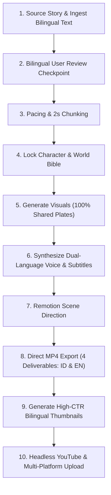

# Storybook & AI Video Storyboard Generator

Transforms open-license children's storybooks and creative folklore concepts into cinematic animated videos with **bilingual editions by default (Bahasa Indonesia & English)** for YouTube (16:9) and TikTok/Shorts/Reels (9:16) using 100% shared visual consistency bibles, neural voiceover, tactile Foley/ASMR sound design, and Remotion video rendering.

## Quick Reference & Prerequisites

| Requirement | Specification | Reference Document |
| :--- | :--- | :--- |
| **Tooling & AI Model Matrix** | Node.js `>=18`, tsx, Remotion, `msedge-tts`, Model Recommendations | [prerequisites.md](./references/prerequisites.md) |
| **Directory Template** | Self-contained story folder, raw files, bibles, exports, `story.json` | [directory-template.md](./references/directory-template.md) |
| **Story Repositories** | SIBI Kemendikbud, Badan Bahasa, StoryWeaver (CC BY 4.0), GDL | [story-sources.md](./references/story-sources.md) |
| **Visual Consistency & Masterboard** | Character Bible, World Bible, 9:16 Poster Sheet, Chained Prompts | [consistency-bible.md](./references/consistency-bible.md) |
| **Cinematography & Motion** | Bang Motion camera laws, multi-plane depth, optional I2V motion | [cinematography.md](./references/cinematography.md) |
| **Audio, Foley & Subtitles** | Azure Neural Voice (`id-ID-GadisNeural` & `en-US-AnaNeural`), Foley/ASMR, kinetic sync | [voiceover-subtitles.md](./references/voiceover-subtitles.md) |
| **Video Rendering** | Remotion CLI render, bilingual 1080p MP4 export (16:9 & 9:16), optional 4K UHD | [remotion-renderer.md](./references/remotion-renderer.md) |
| **Publishing & Distribution** | YouTube Data API v3, auto-chapters, thumbnails, bilingual TikTok/Reels kits | [distribution-upload.md](./references/distribution-upload.md) |
| **Boundaries & Limitations** | YouTube Quota, Thumbnail Burst Limits, CDP WebSockets, TTS Alignment | [limitations-and-workarounds.md](./references/limitations-and-workarounds.md) |

---

## When to Use

* Producing automated children's storybook videos in **both Bahasa Indonesia and English** from public or open-source literature.
* Creating structured scene-by-scene video storyboards and 9:16 infographic visual masterboards.
* Generating short-form animated educational content for TikTok, IG Reels, or YouTube Shorts.
* Requiring strict visual character and environment consistency across multi-scene narrative videos.
* Synthesizing child-friendly dual-language voiceovers paired with tactile Foley/ASMR sound effects and kinetic subtitles.

### When NOT to Use
* Generating live-action videos, photorealistic talking heads, or 3D character avatars.
* Generic text-to-video prompt workflows that do not require character consistency or storybooks.

---

## Step-by-Step Production Workflow



### 1. Ingest Storyline & Local Duplicate Check
* **Duplicate Detection**: Check if `stories/<book-slug>/story.json` exists locally. If present, prompt user with a decision card (Resume & Edit, New Version `-v2`, or Overwrite) before modifying anything.
* Select a legitimate source from [story-sources.md](./references/story-sources.md).
* Initialize the self-contained project container: `stories/<book-slug>/{raw,bible,assets,exports}`.
* **Bilingual Text Extraction (Default)**: Save clean extracted manuscripts for both languages:
  * `raw/source-manuscript-id.txt` (Bahasa Indonesia)
  * `raw/source-manuscript-en.txt` (English translation / original)
* Scaffold `story.json` with bilingual scene mappings using the template in [directory-template.md](./references/directory-template.md).

### 2. Present Bilingual User Review Card
Present the story brief to the user using the review template in [story-sources.md](./references/story-sources.md). Confirm:
* Story titles in both languages (e.g. *Gara-Gara Kucing!* / *It's All the Cat's Fault!*).
* Clean manuscript breakdown across scenes in both Indonesian and English.
* Proposed visual style medium & character attributes.

### 3. Apply 2-Second Rhythmic Pacing
* Target **6.0 to 8.5 seconds** per scene plate.
* Chunk text into **2 to 3 word breath groups** (~1.8s to 2.4s per phrase). Punctuation marks (`,`, `.`, `!`, `?`) force immediate phrase boundaries in both languages.

### 4. Lock Consistency Bibles
* Define the **Character Bible** (immutable physical traits, cultural attire, color palette).
* Save to `bible/character-bible.json` and embed in `story.json`.
* Define the **World Bible** (biome, lighting mood, color hex codes) in `bible/world-bible.json`.
* Select the art medium preset (e.g. *Whimsical Fairytale Watercolor* or *Priya Kuriyan Folk Art Gouache*).
* See detailed schemas and templates in [consistency-bible.md](./references/consistency-bible.md).

### 5. Ingest Artwork (Priority Ladder — 100% Shared Across Languages)
* **Zero Language Redundancy**: All visual plates (`assets/scene_XX.png`, `cover.png`) are text-free and language-agnostic; they are **100% shared between Indonesian and English video deliverables**.
* **Priority 1 (Authentic Clean Plates)**: Check if open-access source provides pristine, text-free digital illustration plates (e.g. GDL H5P bundles, StoryWeaver raw assets). If available, ingest directly into `assets/` (zero AI quota, 100% artist vision).
* **Priority 2 (Source-Fidelity AI Generation)**: When clean authentic artwork is unavailable (e.g. raster scans with baked-in text or plain manuscripts), generate fresh AI illustrations strictly adhering to the character physical traits, attire, species, and environmental setting described in the source manuscript.
* **3D Cover**: 2.5s opener with embossed gold gilded edges and author credit (`assets/cover.png`).
* Never reuse low-res scans with baked-in typography. Append negative constraints (`--no text, no watermark, no typography`). Details in [consistency-bible.md](./references/consistency-bible.md).

### 6. Synthesize Dual-Language Voice, Subtitles & Foley (Default)
* **Indonesian (`id-ID`) Track**: Synthesized via `id-ID-GadisNeural` / `id-ID-ArdiNeural` (pitch: `+20%`, speed: `+5%`). Saved to `assets/id/scene_XX.mp3` & `assets/id/scene_XX_words.json`.
* **English (`en-US` / `en-GB`) Track**: Synthesized via `en-US-AnaNeural` (Child Storyteller) or `en-US-EmmaNeural` (Warm Bedtime). Saved to `assets/en/scene_XX.mp3` & `assets/en/scene_XX_words.json`.
* **Punctuation (*Tanda Baca*) Restoration**: Azure `WordBoundary` strips punctuation; run `attachPunctuation()` to re-align original punctuation (`?`, `!`, `,`, `.`, `...`, hyphens) to timing tokens in both languages.
* **Multi-Speaker Color Tagging**: Assign distinct color accents and avatar tags per persona (Teacher `#38BDF8`, Child `#FDE047`, Narrator `#34D399`).
* Tactile Foley cues saved to `assets/scene_XX_sfx.mp3`. Details in [voiceover-subtitles.md](./references/voiceover-subtitles.md).

### 7. Configure Remotion Scene Direction
* Enforce Bang Motion camera laws: scale `≥ 1.08x`, continuous camera breathing, and alternating motions (`slow_zoom_in`, `pan_right`, `tilt_up`).
* **Zero-Crop Vertical Canvas (9:16 Shorts/Reels)**: Use Ambient Pillarbox Canvas (full-bleed blurred background + floating 16:9 centerpiece plate + subtitles below artwork). Never use raw `objectFit: cover` which cuts off >60% of horizontal action.
* Kinetic subtitles: elastic spring bounce (`scale: 1.25x`), speaker accent color highlight, crisp white past words, safe-zones (`bottom-[18%]` on 9:16). See [cinematography.md](./references/cinematography.md).

### 8. Export Multi-Format MP4 Videos (4 Deliverables by Default)
* Execute Remotion headless rendering CLI commands to export all 4 deliverables (ID 16:9, ID 9:16, EN 16:9, EN 9:16):
  ```bash
  # Render all 4 bilingual video deliverables by default (1080p Full HD)
  npx tsx scripts/render-book.ts --book <book-slug> --lang all --format all

  # Render single language only if requested
  npx tsx scripts/render-book.ts --book <book-slug> --lang id --format all
  npx tsx scripts/render-book.ts --book <book-slug> --lang en --format all

  # Optional 4K UHD Master (Forces YouTube high-bitrate VP9/AV1 codec allocation)
  npx tsx scripts/render-book.ts --book <book-slug> --format all --resolution 4k
  ```
* Deliverables:
  * `stories/<book-slug>/exports/id/<book-slug>-16x9.mp4` & `-9x16.mp4`
  * `stories/<book-slug>/exports/en/<book-slug>-16x9.mp4` & `-9x16.mp4`
* Details in [remotion-renderer.md](./references/remotion-renderer.md).

### 9. Generate High-CTR Bilingual Thumbnails (Popular & Niche Formats)
* Generate high-CTR 1920x1080 thumbnails for both languages before publishing. YouTube thumbnail CTR determines algorithmic reach.
* **Format 1 — Popular Comic Action Hook (`thumbnail-popular.png`)**:
  * Tilted dynamic headline (`rotate(-2deg)`) with heavy dark stroke (`-webkit-text-stroke: 6px #000`) and 3D yellow gradient fill.
  * Attention-grabbing eyebrow pill: `🔥 CERITA ANAK LUCU BANGET!` / `🔥 HILARIOUS KIDS STORYBOOK`.
  * Curiosity gap sticker: `🐶😱 TUGAS DIMAKAN ANJING?!` / `THE DOG ATE MY HOMEWORK?!`.
  * Sticker-bordered hero artwork with white outline and drop-shadow (`0 24px 60px rgba(0,0,0,0.9)`).
  * Safe-zone compliant: Keeps bottom-right quadrant clear of text/faces where YouTube stamps the video runtime overlay.
* **Format 2 — Niche Whimsical Bedtime Storybook (`thumbnail-bedtime.png`)**:
  * Ornate golden picture-book frame with warm ambient stardust lighting and midnight blue gradient.
  * Gold embossed typography, moonlight pill (`🌙 DONGENG SEBELUM TIDUR` / `🌙 BEDTIME READ-ALOUD`), and gentle bedtime subtitle.
* **Format 3 — Vertical 9:16 Shorts & Reels Cover (`thumbnail-vertical.png`)**:
  * Full-bleed ambient backdrop with dramatic centered character card (10px sticker border, 3D drop shadow).
  * High-contrast title typography + curiosity gap hook sticker, safe-zone compliant (top 150px and bottom 300px clear for native player UI).
* **Automated Remotion Still Rendering**:
  ```bash
  # Render all thumbnail variants (Landscape & Vertical Shorts, ID & EN) in <1s:
  npm run thumbnail -- --book <book-slug> --lang all --variant all
  ```
* Deliverables:
  * `stories/<book-slug>/exports/id/thumbnail.png`, `thumbnail-bedtime.png`, & `thumbnail-vertical.png`
  * `stories/<book-slug>/exports/en/thumbnail.png`, `thumbnail-bedtime.png`, & `thumbnail-vertical.png`

### 10. Multi-Platform Idempotent Publishing & Duplicate Prevention
* **Pre-Publishing Deduplication Protocol (Local & Cross-Platform)**:
  * Before publishing any video (YouTube, TikTok, Reels), the pipeline executes a 2-stage deduplication check:
    1. **Local Manifest Probe**: Checks `story.json.publications[platform]` and `story.json.exports` for existing remote video IDs.
    2. **Remote API Live Verification**: Calls the target platform API (`youtube.videos.list` and `youtube.search.list(forMine: true)`) to verify whether the video is already published and active on the channel.
  * **Safe Idempotency Handling**:
    * **Default (Safe Skip)**: If the video is already live on the platform, the upload is skipped with a `🛑 DUPLICATE DETECTED` notice to prevent duplicate content and wasted API quota.
    * **`--resync-all` / `--update-metadata`**: Updates remote title, description, tags, chapters, and custom thumbnails (16:9 for landscape, 9:16 for shorts) across all published videos without re-uploading video files.
    * **`--force` / `--replace`**: Replaces the video by automatically deleting the previous remote upload first (`youtube.videos.delete`), ensuring zero duplicates on the channel.
* **Automated Publishing CLI**:
  ```bash
  # Publish both language editions safely (Idempotent: skips if already live):
  npm run upload -- --book <book-slug> --lang all --format all --privacy unlisted

  # Full resync of title, description, chapters & custom thumbnails across all videos & shorts:
  npm run upload -- --book <book-slug> --lang all --resync-all

  # Force replace video (safely deletes old remote video first before uploading):
  npm run upload -- --book <book-slug> --lang all --force

  # Update custom thumbnails only on existing published videos & shorts:
  npx tsx scripts/upload-youtube.ts --book <book-slug> --lang all --update-thumbnails

  # Clean up older duplicate videos from channel:
  npx tsx scripts/manage-youtube.ts --clean-duplicates
  ```
* Saves returned live video IDs, URLs, and timestamps into `story.json.publications[platform]`. Details in [distribution-upload.md](./references/distribution-upload.md).

---

## Incremental & Non-Destructive Editing

To modify or fix any scene without re-running the entire pipeline or re-spending API quota:

* **Edit Single Visual Plate (Updates Both Languages Instantly)**:
  ```bash
  npx tsx scripts/manage-story.ts --book <book-slug> --scene 2 --asset visual --force
  ```
* **Edit Single Scene Voiceover / Text**:
  ```bash
  # Update scene text in story.json, then:
  npx tsx scripts/manage-story.ts --book <book-slug> --lang en --scene 3 --asset audio --force
  ```
* **Instant Re-render**:
  ```bash
  npx tsx scripts/render-book.ts --book <book-slug> --lang all --format all
  ```
* See full schema, CLI options, and workflows in [directory-template.md](./references/directory-template.md).

---

## Operational Boundaries & Known Limitations

| Domain | Boundary / Limitation | Impact & Error Signature | Standard Operating Procedure / Mitigation |
| :--- | :--- | :--- | :--- |
| **YouTube Quota** | Default 10,000 units/day quota | 4 video releases = ~6,620 units (max 1 full bilingual title/day) | Use `--resync-all` / `--update-metadata` (51 units/video) for revisions; never re-upload binaries to fix metadata. |
| **Thumbnail Velocity** | API burst throttle on `thumbnails.set` | `400/429 The user has uploaded too many thumbnails recently` when updating >3 thumbnails rapidly | Wait 15–30 min cooldown, then run `--update-thumbnails` for remaining videos, or drag-and-drop into YouTube Studio. |
| **Channel Verification** | Phone verification required for custom thumbnails | `403 The authenticated user doesn't have permissions to upload and set custom video thumbnails` | Complete one-time channel verification at `https://www.youtube.com/verify` (Intermediate Features). |
| **Shorts Thumbnails** | Dynamic auto-frame on mobile feed | 9:16 custom cover shows in library/search, but feed may select frame | Select custom frame in mobile YouTube app if specific frame preview is critical. |
| **Remotion CDP Socket** | Headless Chrome WebSocket binds to local `127.0.0.1` | `connect EPERM 127.0.0.1` inside isolated sandboxes | Run render scripts with sandbox network bypass (`BypassSandbox: true` / elevated socket permissions). |
| **4K Memory Spikes** | Chromium worker RAM usage | OOM crashes on systems with <8GB RAM | Default to 1080p Full HD (`1920×1080`); reserve 4K for high-memory machines. |
| **AI Text Hallucination** | Image models generating pseudo-text | Garbled text on posters, books, or clothing | Mandatory negative prompt: `--no text, no watermark, no typography, no letters`; prefer authentic clean plates. |
| **Character Drift** | Inconsistent facial structure or attire across scenes | Morphological drift across generations | Lock physical traits in `Character Bible` (`bible/character-bible.json`) and prepend exact description to every scene prompt. |
| **TTS Punctuation** | Azure `WordBoundary` strips lexical punctuation | Subtitles lose pauses, commas, question/exclamation marks | Run `attachPunctuation()` mapping lexical tokens back to original manuscript words. |
| **Phonetic Quirks** | Neural voice mispronounces acronyms or colloquialisms | Reading *"PR"* as *"purr"* or mispronouncing slang | Pre-normalize acronyms in manuscript (`P-R` or `tugas sekolah`) and colloquialisms (`nggak`). |
| **Deduplication Lag** | YouTube search index eventual consistency (~15 min) | `search.list` misses fresh uploads, risking duplicate insertion | Deduplication engine prioritizes deterministic probing via `youtube.videos.list({ id })` using IDs in `story.json`. |
| See full technical details, quota math, and code workarounds in [limitations-and-workarounds.md](./references/limitations-and-workarounds.md). |

---

## Quality Gate Checklist

Before delivering or publishing:
- [ ] **Local Duplicate Check Respected**: Prompted user before scaffolding when title existed.
- [ ] **Bilingual Video Deliverables Rendered (Default)**: Verified all 4 video files (ID Landscape & Shorts, EN Landscape & Shorts) with smooth 30fps playback.
- [ ] **Zero Language Visual Redundancy**: 100% of illustration plates shared across both languages with zero foreign text overlays.
- [ ] **Artwork Priority Followed**: Authentic clean plates used if present; otherwise source-faithful AI illustrations generated.
- [ ] **Character Consistency**: Protagonist's clothes, hair, and facial features match across all scenes.
- [ ] **Punctuation (*Tanda Baca*) Preserved**: Subtitles in both Indonesian and English retain original commas, question marks, and exclamation marks.
- [ ] **Multi-Speaker Tagging**: Distinct color accents and badges assigned to each persona.
- [ ] **Zero-Crop Vertical Canvas**: 9:16 Shorts/Reels use Ambient Pillarbox Canvas so no artwork is cropped.
- [ ] **Bilingual Multi-Platform Metadata Prepared**: `exports/youtube-upload-metadata.md` generated with timestamps, cross-promotion links, and full attribution.
- [ ] **Bilingual High-CTR Thumbnails Rendered**: Generated 1920x1080 thumbnails in both Popular Comic and Niche Bedtime formats for ID and EN editions with title typography and curiosity hooks.
- [ ] **Cross-Platform Duplicate Prevention Verified**: Confirmed publication idempotency via local manifest and live platform API checks before video insertion.
- [ ] **Automated YouTube Publishing Complete**: Live video URLs for both language editions synced back into `story.json`.

---

## Common Pitfalls & Solutions

| Pitfall | Root Cause | Solution |
| :--- | :--- | :--- |
| **Duplicate video uploads on YouTube/platforms** | Re-uploading without checking remote channel status | Run with pre-upload deduplication; use `--update-metadata` for changes or `--force` to delete old remote video first before replacement. |
| **Generating new images for English version** | Re-running visual pipeline unnecessarily | Reuse 100% of existing visual plates; only synthesize speech audio and word boundaries for English. |
| **Silent overwrite of existing story** | Missing local directory check | Run duplicate check before scaffolding and ask user whether to resume, overwrite, or version. |
| **Reusing scanned pages with baked-in text** | Missing text-only extraction step | Ingest clean H5P plates if available; otherwise generate fresh AI illustrations with strict source fidelity. |
| **Vertical 9:16 crops out side characters** | Raw `objectFit: cover` on 16:9 artwork | Use Ambient Pillarbox Canvas (blurred backdrop + floating 16:9 plate + lower subtitles). |
| **Missing punctuation (*tanda baca*) in subtitles** | Azure TTS `WordBoundary` strips punctuation | Apply `attachPunctuation()` mapping lexical tokens back to original manuscript words. |
| **YouTube video initially plays in 360p/480p** | YouTube processes SD first, HD in 5–15m | Inform user to select 1080p HD in player settings; optional 4K triggers VP9/AV1 codec for highest bitrate. |
| **YouTube API 403 / Access Denied** | API disabled or test user missing | Enable YouTube Data API v3 in GCP and add channel email under OAuth Consent Screen Test Users. |
| **YouTube API 403 on custom thumbnail** | Channel phone verification missing | Visit `https://www.youtube.com/verify` to activate Intermediate Features. |
| **YouTube thumbnail velocity rate-limit** | Updating >3 thumbnails in rapid burst | Trapped gracefully; wait 15–30m cooldown, then run `--update-thumbnails` for remaining videos. |
| **Remotion render fails with `EPERM`** | Headless Chrome WebSocket blocked | Run render outside sandbox (`BypassSandbox: true`) for CDP socket communication. |
| **4K render Chrome tab crash (OOM)** | Memory spikes on 4K canvas | Standardize on 1080p Full HD (`1920×1080`); only use 4K on machines with ≥16GB RAM. |
| **Neural voice mispronounces acronyms ("PR")** | Model interprets acronyms phonetically | Pre-normalize text in manuscript: change "PR" to "P-R" or "tugas sekolah", "ga" to "nggak". |
