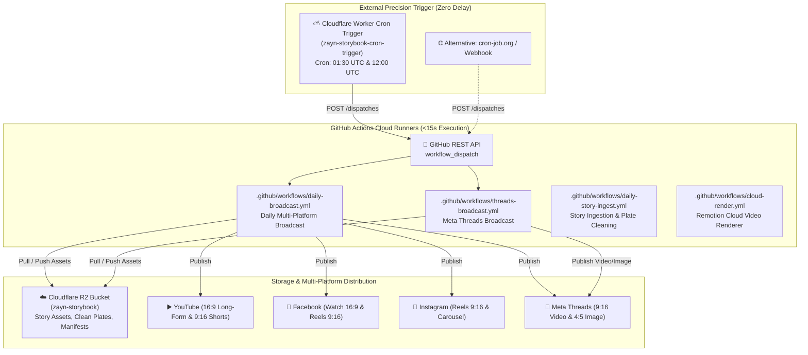

# Cloud Automation, Scheduling & Webhook Triggers Guide

This document defines the complete cloud automation architecture for **Zayn Storybook**, covering serverless cron triggers (Cloudflare Workers), GitHub Actions workflows, Meta Threads publishing, Cloudflare R2 storage integration, and instant CLI dispatch tools.

---

## 1. Cloud Architecture Overview

Publishing children's bedtime and read-aloud storybooks demands strict timing (e.g. 08:30 WIB for morning energy, 19:00 WIB for bedtime). Native GitHub Actions scheduled crons suffer from global queue congestion with delays of 5–7 hours. To ensure 100% on-time releases, the project uses a two-tier hybrid cloud architecture:



---

## 2. Cloudflare Worker Cron Trigger (Precision Serverless Webhook)

### Why Cloudflare Worker?
* **Zero Delay**: Runs precisely at the configured minute via Cloudflare's global edge network.
* **100% Free Tier**: Up to 100,000 requests/day (our usage is 2 executions/day = 60/month).
* **Direct GitHub Dispatch**: Calls GitHub API `workflow_dispatch` endpoint which starts the runner in <15 seconds, bypassing the 5–7 hour `schedule` event queue.

### Worker Source & Config:
Located in `cloudflare/daily-broadcast-cron/`:
* `src/index.js`: Listens to `scheduled()` event, determines target slot (`morning` vs `evening`), and dispatches GitHub Actions with JSON payload.
* `wrangler.toml`: Configures cron triggers and environment bindings:
  ```toml
  name = "zayn-storybook-cron-trigger"
  main = "src/index.js"
  compatibility_date = "2024-09-23"
  account_id = "e5c0394bca4b8239f091b55cb3e9d3e6"

  [triggers]
  crons = ["30 1 * * *", "0 12 * * *"]

  [vars]
  GITHUB_REPO = "ramustha/storybook-video-generator"
  ```

### Automated Deploy CLI:
```bash
# 1. Login to Cloudflare in browser (one-time interactive auth):
npx wrangler login

# 2. Automated deployment + GitHub token secret injection:
npm run deploy:worker
```
*(The helper script `scripts/setup-cloudflare-worker.ts` automatically extracts the active GitHub PAT from `gh` CLI and injects it into Cloudflare Worker secrets).*

---

## 3. GitHub Actions Workflows Matrix

| Workflow File | Trigger Mechanism | Purpose & Key Features |
|---|---|---|
| `.github/workflows/daily-broadcast.yml` | `workflow_dispatch` (via Cloudflare Cron / CLI) & fallback `schedule` | Master daily broadcast engine. Auto-pulls assets from R2, verifies zero duplicate gate, renders missing video on-the-fly, publishes to YouTube, Facebook, Instagram, and Threads, and syncs updated manifest back to R2. |
| `.github/workflows/threads-broadcast.yml` | `workflow_dispatch` | Standalone on-demand Threads publisher. Supports `book` selection or `all`, `mode` (`video`, `image`, `text`), `intro` channel post, `dry_run`, and `force` duplicate override. |
| `.github/workflows/daily-story-ingest.yml` | `workflow_dispatch` & bi-weekly schedule | Ingests new books from `config/curated-books.json`, downloads PDF plates, runs inpainting text cleaning, synthesizes bilingual TTS, and pushes to Cloudflare R2. |
| `.github/workflows/cloud-render.yml` | `workflow_dispatch` | Headless Remotion rendering on GitHub cloud runners for high-resolution 1080p/4K MP4s. Retains artifacts for 7 days and syncs manifests to R2. |
| `.github/workflows/weekly-analytics.yml` | `workflow_dispatch` & weekly cron | Aggregates views, likes, comments, and shares across YouTube, Facebook, Instagram, and Threads, outputting a consolidated markdown summary. |

---

## 4. Editorial Content Calendar & CLI Commands

The calendar orchestrator in `scripts/content-calendar.ts` coordinates daily release themes, language pairs, and target slots:

```bash
# Check today's broadcast schedule and publication status:
npm run schedule:today

# View full monthly content calendar:
npm run schedule:calendar

# Execute today's scheduled broadcast locally:
npm run schedule:today -- --publish-today

# Execute specific slot only (morning or evening):
npm run schedule:today -- --publish-today --slot morning
npm run schedule:today -- --publish-today --slot evening

# Dry-run test of today's schedule without mutations:
npm run schedule:today -- --publish-today --dry-run

# Trigger GitHub Actions cloud broadcast runner instantly via CLI:
npm run broadcast:trigger -- --slot morning
npm run broadcast:trigger -- --slot evening
npm run broadcast:trigger -- --dry-run
```

---

## 5. Meta Threads Publishing & Insights Engine

### Technical Specifications:
* **Video Specification**: MP4 (H.264), 9:16 Vertical, max 5 minutes, max 1GB, framerate 30fps.
* **Image Specification**: JPEG/PNG, 4:5 Portrait (`1080×1350`) or 1:1 Square, max 8MB.
* **Text & Metadata**: Max 500 characters, max 5 link tags, `is_made_with_ai: true` label.
* **Rate Limits**: 250 API published posts per 24-hour rolling window per user account.

### Automated Publishing Commands:
```bash
# Verify Threads API connection and token validity:
npm run auth:threads

# Publish single story video (9:16 Vertical) to Threads:
npm run upload:threads -- --book <book-slug> --mode video

# Publish 4:5 Portrait cover announcement:
npm run upload:threads -- --book <book-slug> --mode image

# Publish all storybooks in catalog:
npm run upload:threads -- --all-books --mode video

# Publish official channel introduction post:
npm run upload:threads -- --intro

# Query unified analytics across Facebook, Instagram & Threads:
npm run stats:meta
```

### Zero Duplicate Protection Doctrine:
Before creating a Threads media container, `publishStoryToThreads()` checks `manifest.publications.threads[lang].id`. If already published, the post is skipped with a `🛡️ [ZERO DUPLICATE GATE]` warning. Pass `--force` to republish.

---

## 6. GitHub Actions Secrets Synchronization

All 22 project credentials and tokens are synchronized to the private GitHub repository with a single command:

```bash
npm run secrets:github
```

| Secret Name | Destination / Usage |
|---|---|
| `PERSONAL_THREADS_ACCESS_TOKEN` | 60-day Long-Lived Meta Threads User Token |
| `PERSONAL_THREADS_USER_ID` | Threads User ID (`31322011817419464`) |
| `PERSONAL_THREADS_APP_ID` | Threads App ID (`1507655221210490`) |
| `PERSONAL_THREADS_APP_SECRET` | Threads App Secret |
| `PERSONAL_META_ACCESS_TOKEN` | Facebook Page & Instagram Graph API Token |
| `PERSONAL_META_PAGE_ID` | Facebook Page ID (`1473240609201601`) |
| `PERSONAL_META_INSTAGRAM_USER_ID` | Instagram User ID (`17841477003917879`) |
| `PERSONAL_R2_ACCOUNT_ID` | Cloudflare Account ID (`e5c0394bca4b8239f091b55cb3e9d3e6`) |
| `PERSONAL_R2_ACCESS_KEY_ID` | Cloudflare R2 S3 Access Key |
| `PERSONAL_R2_SECRET_ACCESS_KEY` | Cloudflare R2 S3 Secret Key |
| `PERSONAL_R2_PUBLIC_DOMAIN` | Cloudflare R2 Public CDN URL |
| `YOUTUBE_CLIENT_ID` | Google Cloud OAuth Client ID |
| `YOUTUBE_CLIENT_SECRET` | Google Cloud OAuth Client Secret |
| `YOUTUBE_REFRESH_TOKEN` | Google Cloud OAuth Refresh Token |

---

## 7. Cloudflare R2 Zero-Repo-Bloat Storage Lifecycle

To prevent git repository bloat, stories and binary assets are stored in Cloudflare R2 (`zayn-storybook`):

```bash
# Push single story assets & manifest (excludes *.mp4):
npm run story:push <book-slug>

# Push updated manifest only:
npm run story:push <book-slug> --manifest-only

# Pull story assets from R2 to local disk:
npm run story:pull <book-slug>

# Synchronize entire catalog with R2:
npm run story:push-all
npm run story:pull-all

# Inspect all stored stories in R2:
npm run story:list
```
