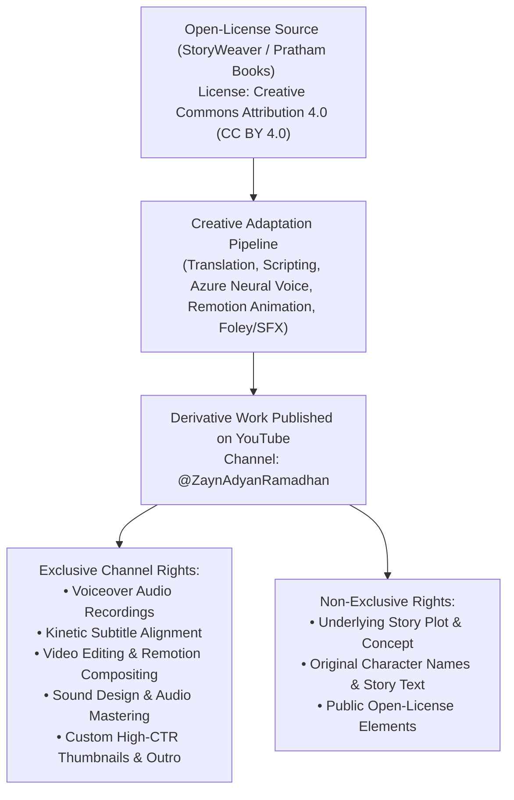
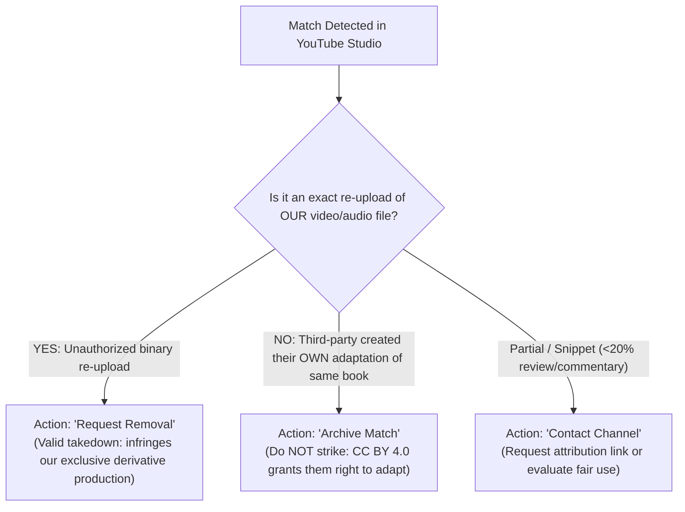

# YouTube Copyright Match Tool & Open-License Compliance Reference

This document defines the copyright compliance, intellectual property boundaries, attribution standards, and enforcement protocols for storybook videos published to YouTube, verified against official Google Support guidelines: [**Use the Copyright Match Tool (support.google.com/youtube/answer/7648743)**](https://support.google.com/youtube/answer/7648743?hl=en-GB).

---

## 1. Legal & Intellectual Property Framework

Children's storybooks generated by this pipeline are **Derivative Works** based on open-license literature:

### A. Creative Commons Attribution 4.0 (CC BY 4.0)
* **Permitted Uses**: You are free to copy, redistribute, transform, adapt, and build upon the material for any purpose, including commercial distribution on YouTube.
* **Mandatory Obligations**: You must give appropriate credit, provide a link to the license, and indicate if changes were made.
* **Every YouTube video description must include complete attribution** with:
  1. Original Book Title & Translated Title
  2. Original Author & Illustrator
  3. Original Publisher / Repository (e.g. Pratham Books / StoryWeaver)
  4. Exact License: `Creative Commons Attribution 4.0 International (CC BY 4.0)`
  5. Direct link to license: `https://creativecommons.org/licenses/by/4.0/`
  6. Source URL of the original book

### B. Ownership Boundaries
* **What We Own (Exclusive Copyright)**:
  - The unique audiovisual recording, voiceover audio performance, Remotion code composition, audio ducking master, kinetic typography, and custom thumbnail graphic assets.
* **What We Do NOT Own (Non-Exclusive)**:
  - The underlying story text and character concepts. Other creators legally have the right to create their own adaptations of the same book from StoryWeaver.

---

## 2. YouTube Copyright Match Tool Guidelines (`answer/7648743`)

The **Copyright Match Tool** automatically scans YouTube uploads to detect full or near-full copies of your videos on other channels.

### A. The "First-to-Upload" Rule
* YouTube's matching algorithm evaluates videos uploaded **after** your publication date.
* Being the first to publish the animated edition on YouTube establishes primary matching authority in YouTube Studio.

### B. Prohibited Claims & Misuse Warning
Google strictly monitors usage of the Copyright Match Tool. Submitting fraudulent or careless copyright takedowns can result in **loss of feature access** or **channel termination**:
* **Prohibited Claims**: You **MUST NOT** file copyright removal requests against videos containing:
  1. Public domain material
  2. Open-license or Creative Commons content (such as other creators adapting the same CC BY 4.0 story)
  3. Content licensed non-exclusively
  4. Valid Fair Use / Fair Dealing transformations

---

## 3. Decision Protocol for YouTube Studio Matches

When reviewing matches under **YouTube Studio $\to$ Copyright / Content detection $\to$ Matches**:

### Action Guidelines:
1. **Request Removal (Takedown)**:
   - Use ONLY when a channel re-uploads our exact video file, our voiceover narration, or substantial parts of our animation without permission.
   - Choose between **Scheduled 7-day notice** (gives uploader time to delete) or **Standard takedown** (immediate strike).
2. **Archive Match**:
   - Use whenever another creator produces their own animation, narration, or video reading of the same StoryWeaver/Pratham Books story.
   - Archived matches are removed from your active review tab and will not be flagged again.
3. **Contact Channel**:
   - Send a direct message to request attribution in the description if a video uses your clip respectfully.

---

## 4. Pre-Publishing Copyright Verification Checklist

Before publishing any storybook video to YouTube, verify:

- [ ] **CC BY 4.0 Attribution in Description**:
  - Author, Illustrator, Publisher, Source URL, and CC BY 4.0 license link are clearly stated in `exports/youtube-upload-metadata.md`.
- [ ] **Audio Clearance (Content ID Safe)**:
  - Voiceover synthesized via licensed TTS (e.g. Azure Neural Speech `id-ID-GadisNeural`, `en-US-AnaNeural`).
  - Background music (BGM) and Foley SFX are 100% royalty-free and unencumbered by Content ID digital fingerprinting.
- [ ] **Artwork Lineage**:
  - Uses authentic CC BY 4.0 plates or newly synthesized illustrations adhering to the Storyboard Bible.
  - Zero third-party logos, trademarked characters, or copyrighted brand elements.
- [ ] **Channel Status Verification**:
  - In [YouTube Studio](https://studio.youtube.com) $\to$ **Content**, confirm the **Restrictions** column states **None** (*Tidak ada*) for all published videos.
