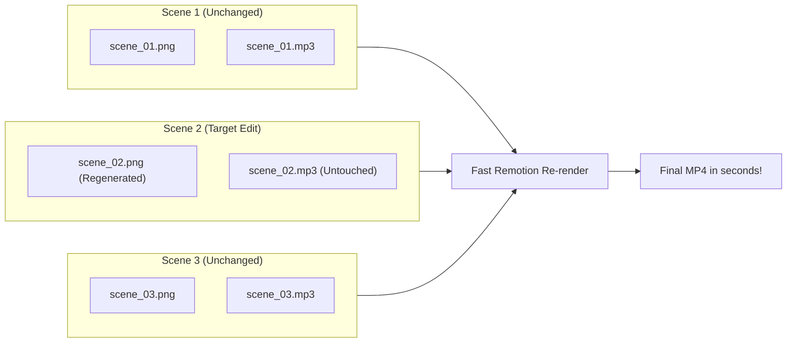

# Storybook Project Directory Template & Editable Workflow

This document defines the standardized directory structure for storybook titles, the master `story.json` manifest schema, and the incremental, non-destructive editing workflow.

---

## 1. Standardized Directory Layout

Every book title resides in its own isolated directory under `stories/<book-slug>/`. All raw source materials, visual bibles, generated media assets, and final rendered videos are co-located within this self-contained container.

```
stories/<book-slug>/
├── story.json                     # Master manifest & scene graph (Single Source of Truth)
├── raw/                           # Raw source manuscripts and approval notes
│   ├── source-manuscript.txt      # Clean extracted text from government/open repository
│   ├── metadata.json              # Source repository metadata (URL, license, authors)
│   └── user-review-card.md        # Approved story brief & scene breakdown
├── bible/                         # Consistency anchors & style definitions
│   ├── character-bible.json       # Visual physical anchors, attire, palette
│   └── world-bible.json           # Environment, lighting, color palette
├── assets/                        # Generated individual scene media (Atomic assets)
│   ├── storyboard-poster.png      # Visual masterboard infographic reference sheet
│   ├── cover.png                  # Shared 3D Book cover illustration plate (Language-agnostic)
│   ├── scene_01.png               # Shared Scene 1 illustration plate (Language-agnostic)
│   ├── scene_01_sfx.mp3           # Scene 1 synchronized tactile ASMR/foley track
│   ├── id/                        # Indonesian Language Audio & Subtitle Track
│   │   ├── scene_01.mp3           # Indonesian voiceover (id-ID-GadisNeural)
│   │   └── scene_01_words.json    # Indonesian word boundary timestamps & punctuation
│   ├── en/                        # English Language Audio & Subtitle Track
│   │   ├── scene_01.mp3           # English voiceover (en-US-AnaNeural)
│   │   └── scene_01_words.json    # English word boundary timestamps & punctuation
│   └── ...                        # Additional scenes (N)
└── exports/                       # Final rendered video & thumbnail deliverables
    ├── id/                        # Indonesian Video Deliverables & Thumbnails
    │   ├── <book-slug>-16x9.mp4   # YouTube Landscape Full HD (Indonesian subtitles)
    │   ├── <book-slug>-9x16.mp4   # Shorts / Reels Vertical Full HD (Indonesian subtitles)
    │   ├── thumbnail-popular.png  # High-CTR Comic Action Thumbnail (Indonesian)
    │   ├── thumbnail-bedtime.png  # Whimsical Storybook Bedtime Thumbnail (Indonesian)
    │   └── thumbnail.png          # Default primary thumbnail (Indonesian)
    ├── en/                        # English Video Deliverables & Thumbnails
    │   ├── <book-slug>-16x9.mp4   # YouTube Landscape Full HD (English subtitles)
    │   ├── <book-slug>-9x16.mp4   # Shorts / Reels Vertical Full HD (English subtitles)
    │   ├── thumbnail-popular.png  # High-CTR Comic Action Thumbnail (English)
    │   ├── thumbnail-bedtime.png  # Whimsical Storybook Bedtime Thumbnail (English)
    │   └── thumbnail.png          # Default primary thumbnail (English)
    ├── thumbnail.png              # Root preview thumbnail
    └── youtube-upload-metadata.md # Pre-formatted multi-platform metadata package (ID & EN)
```

### Purpose of Co-located Directories:
1. **Total Portability**: The entire book project can be archived, backed up, or shared by copying a single folder.
2. **Zero Orphaned Assets**: Media files are explicitly bound to their story folder; no cross-pollution in shared `temp` or `public` folders.
3. **Auditable Lineage**: Source license, character bibles, and generated assets live side-by-side for legal attribution and verification.

---

## 2. Master Manifest Schema (`story.json`)

The `story.json` file controls the entire production pipeline. Every script (visual generator, TTS synthesizer, and Remotion video renderer) reads and updates this file.

```json
{
  "$schema": "./schema.json",
  "version": "1.0.0",
  "id": "gara-gara-kucing",
  "slug": "gara-gara-kucing",
  "title": "Gara-Gara Kucing",
  "language": "id-ID",
  "source": {
    "repository": "SIBI Kemendikbud",
    "license": "Creative Commons Attribution-NonCommercial-ShareAlike 4.0",
    "originalAuthor": "M. Aan Mansyur",
    "originalIllustrator": "Heri Pemad Organizers",
    "sourceUrl": "https://buku.kemdikbud.go.id/katalog/buku-non-teks/gara-gara-kucing"
  },
  "stylePreset": {
    "artMedium": "Whimsical Children's Book Watercolor & Soft Gouache",
    "artistInfluences": "Beatrix Potter, Priya Kuriyan",
    "renderingConstraints": "matte finish, clean lines, storybook illustration, no text, no watermark"
  },
  "characterBible": {
    "protagonists": [
      {
        "name": "Kucing Oranye",
        "species": "Cat",
        "description": "Round chubby ginger tabby cat with warm amber eyes, white bib chest, pink paw pads, expressive ears",
        "palette": ["#E28743", "#FFFFFF", "#EAB676"]
      }
    ]
  },
  "worldBible": {
    "setting": "Traditional Indonesian village house veranda with potted jasmine flowers and morning sunlight",
    "lighting": "Warm morning golden hour, soft pastel shadows",
    "colorPalette": ["#FDFBF7", "#C5D8A4", "#539165", "#E28743"]
  },
  "scenes": [
    {
      "index": 0,
      "sceneId": "cover",
      "type": "cover",
      "durationSeconds": 2.5,
      "visual": {
        "imagePath": "assets/cover.png",
        "prompt": "Whimsical children's book cover illustration of a cute chubby orange tabby cat sleeping peacefully on a wooden chair, lush morning tropical garden background, storybook illustration, soft gouache watercolor, warm lighting --no text, no watermark",
        "status": "ready"
      },
      "audio": {
        "id": {
          "text": "Gara-Gara Kucing! Karya Anushka Ravishankar dan Priya Kuriyan.",
          "audioPath": "assets/id/cover.mp3",
          "wordsPath": "assets/id/cover_words.json"
        },
        "en": {
          "text": "It's All the Cat's Fault! By Anushka Ravishankar and Priya Kuriyan.",
          "audioPath": "assets/en/cover.mp3",
          "wordsPath": "assets/en/cover_words.json"
        },
        "status": "ready"
      },
      "camera": {
        "motion": "slow_zoom_in",
        "scaleStart": 1.0,
        "scaleEnd": 1.12
      }
    },
    {
      "index": 1,
      "sceneId": "scene_01",
      "type": "narrative",
      "durationSeconds": 7.2,
      "visual": {
        "imagePath": "assets/scene_01.png",
        "prompt": "A chubby orange tabby cat knocking over a glass of milk on a rustic kitchen table, white milk splashing dynamically, wooden floor, warm rustic kitchen, storybook gouache watercolor --no text, no typography",
        "status": "ready"
      },
      "audio": {
        "id": {
          "text": "Pagi ini, si Kucing Oranye melompat ke meja makan. Tiba-tiba, gelas susu berguling!",
          "audioPath": "assets/id/scene_01.mp3",
          "wordsPath": "assets/id/scene_01_words.json"
        },
        "en": {
          "text": "This morning, the Orange Cat jumped onto the dining table. Suddenly, the glass of milk rolled over!",
          "audioPath": "assets/en/scene_01.mp3",
          "wordsPath": "assets/en/scene_01_words.json"
        },
        "sfxPath": "assets/scene_01_sfx.mp3",
        "foleyCue": "Glass cup clattering and rolling across wood, milk splashing onto table",
        "status": "ready"
      },
      "camera": {
        "motion": "pan_right",
        "scaleStart": 1.1,
        "scaleEnd": 1.15,
        "panStart": { "x": -2, "y": 0 },
        "panEnd": { "x": 2, "y": 0 }
      }
    }
  ],
  "exports": {
    "id": {
      "landscape": { "path": "exports/id/gara-gara-kucing-16x9.mp4", "resolution": "1920x1080", "status": "rendered" },
      "vertical": { "path": "exports/id/gara-gara-kucing-9x16.mp4", "resolution": "1080x1920", "status": "rendered" }
    },
    "en": {
      "landscape": { "path": "exports/en/its-all-the-cats-fault-16x9.mp4", "resolution": "1920x1080", "status": "rendered" },
      "vertical": { "path": "exports/en/its-all-the-cats-fault-9x16.mp4", "resolution": "1080x1920", "status": "rendered" }
    }
  },
  "publications": {
    "youtube": {
      "id": {
        "landscape": { "id": "Ladb_oJ-1-U", "url": "https://youtu.be/Ladb_oJ-1-U", "status": "published" },
        "vertical": { "id": "37P1i6JEiwE", "url": "https://youtube.com/shorts/37P1i6JEiwE", "status": "published" }
      },
      "en": {
        "landscape": { "id": "6sLTErwRXsk", "url": "https://youtu.be/6sLTErwRXsk", "status": "published" },
        "vertical": { "id": "TRDw6JX8m5M", "url": "https://youtube.com/shorts/TRDw6JX8m5M", "status": "published" }
      }
    },
    "tiktok": {
      "id": { "status": "pending" },
      "en": { "status": "pending" }
    }
  }
}
```

---

## 3. Incremental & Non-Destructive Editing Workflow

### The Problem With Monolithic Pipelines
In a standard sequential script, fixing one scene (e.g. modifying Scene 2's cat expression or correcting a mispronounced word in Scene 3) requires re-running the entire script. This burns API quotas, changes seeds on other scenes, wastes time, and risks introducing new bugs.

### The Atomic Asset Principle
Every scene has its own independent assets (`scene_XX.png`, `scene_XX.mp3`, `scene_XX_words.json`). Modifying one scene never alters any other scene.



---

## 4. Granular CLI Commands

Use the unified pipeline script `scripts/manage-story.ts` with granular flags:

### A. Check Project Status
Inspect which assets exist and which scenes are missing visuals or audio:
```bash
npx tsx scripts/manage-story.ts --book <book-slug> --status
```

### B. Re-generate Visual Plate for a Single Scene
If Scene 2's image plate needs an update (e.g., tweaked prompt or character pose):
```bash
# Re-generate only Scene 2 image plate without touching any audio or other scenes
npx tsx scripts/manage-story.ts --book <book-slug> --scene 2 --asset visual --force
```

### C. Re-synthesize Audio for a Single Scene
If Scene 3 has a mispronounced word or text tweak:
```bash
# 1. Edit text in story.json for Scene 3
# 2. Re-synthesize audio & recalculate word timestamps for Scene 3 only
npx tsx scripts/manage-story.ts --book <book-slug> --scene 3 --asset audio --force
```

### D. Add or Reorder Scenes
1. Insert a new scene object into `story.json` at the desired position.
2. Run asset generation in incremental mode (only generates missing assets):
```bash
npx tsx scripts/manage-story.ts --book <book-slug> --fill-missing
```

### E. Fast Re-rendering (Direct Compositing)
Re-render the final MP4s immediately using existing cached assets. This completes in seconds:
```bash
# Render both Landscape (16:9) and Vertical (9:16) (optional --resolution 4k)
npx tsx scripts/render-book.ts --book <book-slug> --format all
```

### F. Automated YouTube & Social Publishing
Publish rendered deliverables, thumbnails, and descriptions directly to YouTube with automated chapters:
```bash
# Upload both formats as 'unlisted' for preview (or 'public')
npm run upload -- --book <book-slug> --format all --privacy unlisted
```

---

## 5. TypeScript Script Implementation (`scripts/manage-story.ts`)

Here is the reference script implementing selective, non-destructive management with local duplicate detection, exact punctuation restoration, and multi-speaker color tagging:

```ts
import fs from "fs/promises";
import path from "path";
import os from "os";
import { MsEdgeTTS, OUTPUT_FORMAT } from "msedge-tts";

export interface WordTiming {
  word: string;
  start: number;
  end: number;
  speaker: string;
  speakerName: string;
  speakerColor: string;
}

/**
 * Attaches original manuscript punctuation (tanda baca: ? ! , . ...)
 * back to stripped Azure Speech WordBoundary lexical tokens.
 */
export function attachPunctuation(azureWords: string[], originalText: string): string[] {
  const originalTokens = originalText.trim().split(/\s+/);
  const clean = (s: string) => s.toLowerCase().replace(/[^a-zA-Z0-9-]/g, "");

  let tokenIdx = 0;
  return azureWords.map((azWord) => {
    for (let i = tokenIdx; i < originalTokens.length; i++) {
      const orig = originalTokens[i];
      if (clean(orig).includes(clean(azWord)) || clean(azWord).includes(clean(orig))) {
        tokenIdx = i + 1;
        return orig;
      }
    }
    return azWord;
  });
}

/**
 * Assigns speaker persona, display name, and subtitle accent color.
 */
export function assignSpeaker(sceneId: string, word: string, wordIndex: number, totalWords: number) {
  if (sceneId === "cover") {
    return { speaker: "narator", speakerName: "Narator", speakerColor: "#34D399" }; // Emerald Mint
  }
  // Example dialogue switching (e.g. Teacher question vs child response)
  if (sceneId === "scene_01" && wordIndex < 5) {
    return { speaker: "guru", speakerName: "Ibu Guru", speakerColor: "#38BDF8" }; // Sky Blue
  }
  return { speaker: "protagonist", speakerName: "Tokoh Utama", speakerColor: "#FDE047" }; // Golden Yellow
}

/**
 * Check if a story project already exists locally.
 * Prevents accidental overwrite of existing work.
 */
export async function checkExistingStory(bookSlug: string): Promise<boolean> {
  const storyDir = path.resolve(`./stories/${bookSlug}`);
  const manifestPath = path.join(storyDir, "story.json");
  return fs.access(manifestPath).then(() => true).catch(() => false);
}

async function loadStory(bookSlug: string) {
  const storyDir = path.resolve(`./stories/${bookSlug}`);
  const manifestPath = path.join(storyDir, "story.json");
  const manifestRaw = await fs.readFile(manifestPath, "utf-8");
  return { storyDir, manifestPath, story: JSON.parse(manifestRaw) };
}

async function synthesizeSceneAudio(storyDir: string, scene: any) {
  const tts = new MsEdgeTTS();
  await tts.setMetadata("id-ID-GadisNeural", OUTPUT_FORMAT.AUDIO_24KHZ_96KBITRATE_MONO_MP3, {
    wordBoundaryEnabled: true,
    sentenceBoundaryEnabled: true,
  });

  const audioFullPath = path.join(storyDir, scene.audio.audioPath);
  const wordsFullPath = path.join(storyDir, scene.audio.wordsPath);
  await fs.mkdir(path.dirname(audioFullPath), { recursive: true });

  console.log(`🎙 Synthesizing audio for Scene ${scene.index} [${scene.sceneId}]: "${scene.audio.text}"`);

  const tempDir = await fs.mkdtemp(path.join(os.tmpdir(), "storybook-tts-"));
  const { audioFilePath, metadataFilePath } = await tts.toFile(tempDir, scene.audio.text, {
    pitch: "+20%",
    rate: "+5%",
  });

  await fs.copyFile(audioFilePath, audioFullPath);

  const words: WordTiming[] = [];
  if (metadataFilePath) {
    try {
      const metadataRaw = await fs.readFile(metadataFilePath, "utf-8");
      const parsed = JSON.parse(metadataRaw);
      const wordItems = (parsed.Metadata || []).filter((item: any) => item.Type === "WordBoundary");
      const rawWordTexts = wordItems.map((item: any) => item.Data?.text?.Text || "");
      const punctuatedWords = attachPunctuation(rawWordTexts, scene.audio.text);

      wordItems.forEach((item: any, idx: number) => {
        const rawText = punctuatedWords[idx] || item.Data?.text?.Text || "";
        const offsetTicks = item.Data?.Offset || 0;
        const durTicks = item.Data?.Duration || 0;
        const startSec = parseFloat((offsetTicks / 10_000_000).toFixed(2));
        const endSec = parseFloat(((offsetTicks + durTicks) / 10_000_000).toFixed(2));
        const speakerMeta = assignSpeaker(scene.sceneId, rawText, idx, wordItems.length);

        words.push({
          word: rawText,
          start: startSec,
          end: endSec,
          ...speakerMeta,
        });
      });
    } catch (e) {
      console.warn(`Warning: failed to parse metadata for scene ${scene.sceneId}:`, e);
    }
  }

  // Calculate actual duration with comfortable reading tail (+0.8s)
  const lastWordEnd = words.length > 0 ? words[words.length - 1].end : 5.0;
  scene.durationSeconds = parseFloat((lastWordEnd + 0.8).toFixed(1));

  await fs.writeFile(wordsFullPath, JSON.stringify({ words }, null, 2));
  scene.audio.status = "ready";
  await fs.rm(tempDir, { recursive: true, force: true }).catch(() => {});
  console.log(`✔ Scene ${scene.index} synchronized (${words.length} words, duration: ${scene.durationSeconds}s)`);
}

async function main() {
  const args = process.argv.slice(2);
  const getArg = (flag: string) => {
    const idx = args.indexOf(flag);
    return idx !== -1 ? args[idx + 1] : undefined;
  };

  const bookSlug = getArg("--book");
  if (!bookSlug) {
    console.error("Error: --book <book-slug> is required.");
    process.exit(1);
  }

  const { storyDir, manifestPath, story } = await loadStory(bookSlug);

  // Status check flag
  if (args.includes("--status")) {
    console.log(`\n📖 Status for "${story.title}" (${bookSlug}):`);
    for (const scene of story.scenes) {
      const imgExists = await fs.access(path.join(storyDir, scene.visual.imagePath)).then(() => true).catch(() => false);
      const audioExists = await fs.access(path.join(storyDir, scene.audio.audioPath)).then(() => true).catch(() => false);
      console.log(`  Scene ${scene.index} [${scene.sceneId}]: Visual: ${imgExists ? "✔" : "❌"} | Audio: ${audioExists ? "✔" : "❌"} | Duration: ${scene.durationSeconds}s`);
    }
    return;
  }

  const sceneIdx = getArg("--scene") ? parseInt(getArg("--scene")!, 10) : undefined;
  const assetType = (getArg("--asset") as "visual" | "audio" | "all") || "all";
  const force = args.includes("--force");

  for (const scene of story.scenes) {
    if (sceneIdx !== undefined && scene.index !== sceneIdx) {
      continue;
    }

    const audioPath = path.join(storyDir, scene.audio.audioPath);
    const audioExists = await fs.access(audioPath).then(() => true).catch(() => false);

    if ((assetType === "audio" || assetType === "all") && (!audioExists || force)) {
      await synthesizeSceneAudio(storyDir, scene);
    } else {
      console.log(`⏭ Scene ${scene.index} audio cached, skipping.`);
    }
  }

  await fs.writeFile(manifestPath, JSON.stringify(story, null, 2));
  console.log(`\n✔ story.json updated successfully.`);
}

main().catch(console.error);
```

---

## 6. Directory Template Initialization Checklist

When starting a new book:
1. `mkdir -p stories/<book-slug>/{raw,bible,assets,exports}`
2. Save raw manuscript to `stories/<book-slug>/raw/source-manuscript.txt`.
3. Scaffold `stories/<book-slug>/story.json` with Character & World bibles.
4. Run incremental generation commands.
5. Render directly to `stories/<book-slug>/exports/`.
