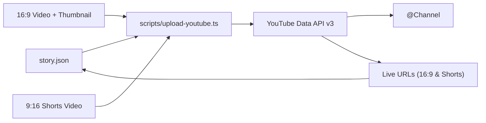
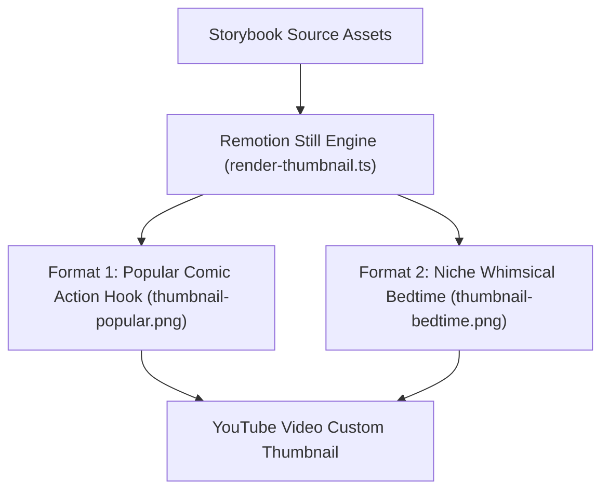

# Multi-Platform Distribution & Automated Upload Guide

This document defines the automated publishing pipeline for YouTube, multi-platform metadata formatting (YouTube, TikTok, Instagram Reels), 4K rendering options, and API quota management.

---

## 1. Multi-Platform Publishing Matrix

| Platform | Format | Aspect Ratio & Res | Max Duration | Key Strategic Feature |
| :--- | :--- | :--- | :--- | :--- |
| **YouTube Long-Form** | Full Story Video | 16:9 (1920×1080 or 4K 3840×2160) | Unlimited | Auto-generated chapters, custom thumbnail, full CC BY 4.0 attribution, search SEO |
| **YouTube Shorts** | Quick Story Snack | 9:16 (1080×1920 or 4K 2160×3840) | Up to 3 mins | Ambient Pillarbox Canvas, `#Shorts` tagging, "Related Video" link to 16:9 full video |
| **TikTok** | Short-Form Video | 9:16 (1080×1920) | Up to 10 mins | Punchy hook captions (<150 chars), safe-zone adherence (bottom 18%), viral sound cues |
| **Instagram Reels** | Short-Form Video | 9:16 (1080×1920) | Up to 90s | High-aesthetic visual cover, carousel caption storytelling, parenting/children hashtags |

---

## 2. Automated YouTube Data API Pipeline (`scripts/upload-youtube.ts`)

The project includes a unified, headless publishing script that reads `story.json` and publishes both formats automatically.



### Key Automated Capabilities:
1. **Cross-Platform Pre-Upload Deduplication**: Probes local manifests (`story.json.publications`) and remote APIs before every upload. If a video is already live on the channel, skips re-uploading automatically to eliminate duplicate content.
2. **Safe Replacement & In-Place Metadata Updates**:
   - `--update-metadata`: Updates title, description, tags, and custom thumbnails without re-uploading the video file or changing the video URL.
   - `--force` / `--replace`: Safely deletes the old remote video first (`youtube.videos.delete`) before inserting the replacement, maintaining a clean 1-video-per-format channel feed.
3. **Dynamic Chapter Generation**: Calculates cumulative scene durations from `story.scenes` and formats exact YouTube description chapters (`00:00 Opening`, `00:06 Scene 1`, etc.).
4. **Automated Thumbnail Upload**: Automatically uploads and pairs `exports/<lang>/thumbnail.png` to the widescreen video.
5. **Headless Persistent OAuth**: Uses Google OAuth 2.0 with offline refresh tokens stored in `config/youtube-token.json`. Once authenticated, runs headlessly in terminal or CI/CD pipelines without browser prompts.
6. **Bidirectional Multi-Platform Sync**: Writes returned platform video IDs, URLs, and publication timestamps into `story.json.publications[platform]`.

### CLI Commands:
```bash
# 1. First-time authorization check
npm run upload -- --auth-only

# 2. Idempotent upload for both languages (Safe: skips if already published)
npm run upload -- --book <book-slug> --lang all --format all --privacy unlisted

# 3. Update metadata, description & custom thumbnail only (zero re-upload)
npm run upload -- --book <book-slug> --lang all --update-metadata

# 4. Force replace (safely deletes old remote video first before uploading new file)
npm run upload -- --book <book-slug> --lang all --force

# 5. Clean up duplicate videos from channel
npx tsx scripts/manage-youtube.ts --clean-duplicates
```

### Dual-Language Publishing Strategy:
* **Separate Videos per Language (Recommended)**:
  * **Indonesian Edition**: Captures local search traffic (`dongeng anak`, `cerita sebelum tidur`, `kartun anak`).
  * **English Edition**: Captures international and ESL audiences (`kids bedtime storybook`, `children audio book`), yielding 3×–6× higher global YouTube RPM.
  * **Cross-Promotion**: Place mutual video links at the top of descriptions:  
    * In ID video: *“🇺🇸 Watch in English: https://youtu.be/<en_id>”*  
    * In EN video: *“🇮🇩 Tonton dalam Bahasa Indonesia: https://youtu.be/<id_id>”*

---

## 3. Video Quality & 4K UHD Option

### Resolution & Bitrate Matrix

| Setting | 16:9 Resolution | 9:16 Resolution | Bitrate (H.264) | Best Use Case |
| :--- | :--- | :--- | :--- | :--- |
| **1080p Full HD (Default)** | 1920 × 1080 | 1080 × 1920 | ~4.5 Mbps | Fast rendering (~1 min), lightweight uploads (30–45 MB), crisp 1080p playback. |
| **4K UHD (Optional)** | 3840 × 2160 | 2160 × 3840 | ~18–22 Mbps | Premium production. **Forces YouTube to assign its high-bitrate VP9/AV1 codec**, completely eliminating re-compression artifacts even on 1080p screens. |

### Optional 4K Rendering CLI:
```bash
# Render 4K UHD versions for YouTube VP9/AV1 allocation
npx tsx scripts/render-book.ts --book <book-slug> --format all --resolution 4k
```

### YouTube Processing Stages
* **Stage 1 (Upload)**: Rapid binary upload over resumable streams.
* **Stage 2 (SD Processing)**: YouTube generates 360p/480p preview within 1–2 minutes.
* **Stage 3 (HD / 4K Processing)**: YouTube transcodes 1080p / 4K with AV1/VP9 within 5–15 minutes.
* *Note: When viewing immediately after upload, manually switch the player gear ⚙️ icon to 1080p HD if it defaults to Auto.*

---

## 4. Multi-Provider Metadata Package (`exports/youtube-upload-metadata.md`)

Every book directory generates a standardized metadata package ready for copy-pasting into web uploaders:

```markdown
# Multi-Platform Metadata Package: <Book Title>

## 1. YouTube Long-Form (16:9)
- Title: [Engaging Hook Title] 🐱 Dongeng Cerita Anak Lucu | Animasi Buku Bergambar
- Description:
  [Hook & Synopsis]
  ⏱️ TIMESTAMPS / CHAPTERS:
  00:00 Pembuka: <Title>
  00:06 Scene 1: <Text snippet>
  ...
  💡 PESAN MORAL:
  [Educational takeaway]
  📜 LISENSI & ATRIBUSI:
  [CC BY 4.0, Author, Illustrator, Publisher, Source URL]
  🎬 KREDIT:
  [Voiceover, Remotion engine, Channel Handle]
- Tags: dongeng anak, cerita anak bergambar, animasi indonesia, bedtime story, ...
- Category: Film & Animation or Education
- Made for Kids: No, it's not made for kids (enables comments & playlist adds)

## 2. YouTube Shorts (9:16)
- Title: <Catchy Hook Question> 😂 #Shorts #DongengAnak
- Description: Short synopsis + credits + "Watch full 16:9 video on channel!"
- Related Video: Linked to the 16:9 video via YouTube Studio

## 3. TikTok & Instagram Reels
- Caption (<150 chars):
  "Tugas sekolah dimakan anjing gara-gara kucing oranye? 😂🐱 Tonton cerita lengkapnya di YouTube Zayn Adyan Ramadhan! #DongengAnak #CeritaAnak #AnimasiIndonesia #KucingOranye"
```

---

## 5. YouTube Thumbnail CTR Engineering (Popular & Niche Formats)

Thumbnails are the single highest leverage point for YouTube CTR (Click-Through Rate). In children's storybooks and animated bedtime stories, two distinct visual formulas deliver top performance:



### Format 1: Popular Comic Action Hook (`thumbnail-popular.png`)
* **Primary Objective**: Maximum CTR across YouTube Home browse features, recommended feeds, and search results.
* **Target Audience**: Kids, families, and viewers searching for funny cartoons and engaging stories.
* **Visual Blueprint**:
  * **Dynamic Tilted Headline**: Set at `rotate(-2deg)` with 3D drop shadow (`0 8px 0 #B45309`), thick black stroke (`-webkit-text-stroke: 6px #000000`), and radiant yellow/white gradient.
  * **High-Energy Eyebrow Pill**: Red/yellow badge (`🔥 CERITA ANAK LUCU BANGET!` / `🔥 HILARIOUS KIDS STORYBOOK`) with high-contrast border.
  * **Curiosity Gap Sticker**: Cyan/yellow sticker badge angled at `rotate(1.5deg)` (`🐶😱 TUGAS DIMAKAN ANJING?!` / `THE DOG ATE MY HOMEWORK?!`).
  * **Sticker-Bordered Hero Artwork**: Main character plate framed in a clean 8px white sticker border with deep ambient shadow (`0 24px 60px rgba(0,0,0,0.9)`).
  * **YouTube Safe-Zone Compliance**: Bottom-right corner kept completely clear of text, faces, or important action where YouTube overlays the video runtime duration stamp (`01:17`).

### Format 2: Niche Whimsical Bedtime Storybook (`thumbnail-bedtime.png`)
* **Primary Objective**: High viewer retention, calm aesthetic, and Montessori/parent trust for bedtime reading.
* **Target Audience**: Parents searching for gentle bedtime read-alouds, teachers, and quiet-time viewing.
* **Visual Blueprint**:
  * **Gilded Storybook Frame**: Artwork displayed within an embossed golden picture book frame (`border: 5px solid rgba(251, 191, 36, 0.9)`).
  * **Twilight Starfield Backdrop**: Deep midnight navy gradient (`#060913` to `#1E1B4B`) with blurred ambient artwork glow and stardust lighting.
  * **Storybook Display Typography**: Elegant gold-leaf gradient text (`#FFFBEB` to `#F59E0B`) with soft cinematic drop shadow.
  * **Bedtime Moon Pill**: Indigo and gold badge (`🌙 DONGENG SEBELUM TIDUR` / `🌙 BEDTIME READ-ALOUD`).
  * **Author & Illustrator Attribution**: Credited in clean subtitle typography.

### Automated Thumbnail Generation CLI:
```bash
# Render all 4 thumbnail deliverables (ID & EN × Popular & Bedtime) in 1920×1080 Full HD:
npm run thumbnail -- --book <book-slug> --lang all --variant all

# Render specific language or variant only:
npm run thumbnail -- --book <book-slug> --lang id --variant popular
npm run thumbnail -- --book <book-slug> --lang en --variant bedtime

# Update thumbnails on already published YouTube videos:
npx tsx scripts/upload-youtube.ts --book <book-slug> --lang all --update-thumbnails
```

### YouTube Custom Thumbnail Eligibility & Burst Throttling
* **Phone Verification**: YouTube Data API requires the uploading channel to have **Intermediate Features (Phone Verification)** enabled:
  * Visit: [https://www.youtube.com/verify](https://www.youtube.com/verify)
* If phone verification is pending, YouTube API returns `403 The authenticated user doesn't have permissions to upload and set custom video thumbnails`. The script catches this gracefully.

---

## 6. Short-Form (9:16) & Multi-Platform Cover Artwork

Each short-form platform handles covers differently. The pipeline enforces platform-specific mechanics so covers are never blank or awkward:

| Platform | Format / API Parameter | Behavior & Guarantee |
| :--- | :--- | :--- |
| **YouTube Shorts** | `youtube.thumbnails.set` & Video Frame 0 | **Desktop & Search**: API attaches `thumbnail-vertical.png`.<br>**Mobile Shorts Feed**: YouTube auto-selects a video frame from 0:00–1:00s. Since `CoverScene` initializes at `bookScale >= 0.94`, the mobile feed preview automatically displays the full 3D storybook cover. |
| **Instagram Reels** | `cover_url` (Container creation) | `scripts/upload-meta.ts` temporarily uploads `thumbnail-vertical.png` to Cloudflare R2, passes `cover_url` to Meta Graph API, and deletes the temporary R2 file once registered. The Instagram Profile Grid and Reels tab display the custom cover. |
| **Facebook Reels** | `POST /{video-id}/thumbnails` | Attached via Meta Graph API multipart upload with `is_preferred=true` using `thumbnail-vertical.png`. |
| **TikTok** | `video_cover_timestamp_ms: 1000` | TikTok Content Posting API selects the video frame at 1000ms (1.0s), which displays the full-bloom `CoverScene`. |

* **Thumbnail Velocity Throttling**: YouTube enforces an unadvertised burst rate limit on `thumbnails.set`. When setting >3 thumbnails rapidly in succession, YouTube temporarily throttles subsequent thumbnail requests with `The user has uploaded too many thumbnails recently. Please try the request again later.`. The upload engine traps this with a warning without breaking the pipeline. Allow 15–30 minutes cooldown before running `--update-thumbnails` for remaining videos, or drag-and-drop into YouTube Studio.
* The generated `thumbnail.png` in `exports/id/` and `exports/en/` can always be manually attached with a single click in [YouTube Studio](https://studio.youtube.com).

---

## 6. API Quota Management & Operational Limits

Google Cloud YouTube Data API v3 enforces a default free quota of **10,000 units per day** (resets 07:00 UTC):
* `videos.insert` (Video binary upload): **1,600 units**
* `thumbnails.set` (Custom thumbnail upload): **50 units**
* `videos.update` (Metadata revision): **50 units**
* `videos.delete` (Remove remote duplicate): **50 units**
* `videos.list` (Idempotency status check): **1 unit**

### Capacity Per Quota Cycle:
* **Single-Language Package (2 Videos: 16:9 + Shorts)**: `(1600 + 50) × 2 ≈ 3,300 units` → Up to **3 stories/day**.
* **Bilingual Package (4 Videos: ID & EN × 16:9 & Shorts)**: `(1600 + 50) × 4 ≈ 6,620 units` → **1 full bilingual story/day**.
* **Metadata & Thumbnail Resync (`--resync-all`)**: `(50 + 50 + 1) × 4 ≈ 404 units` → Consumes <5% of daily quota. Never re-upload video binaries to correct titles, timestamps, or thumbnails.

See complete catalog of boundaries and edge cases in [limitations-and-workarounds.md](./limitations-and-workarounds.md).
