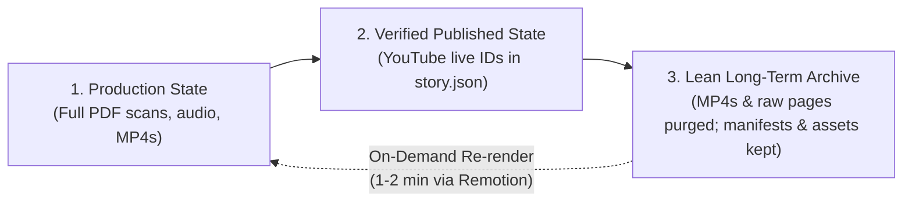

# Storage Cleanup & Post-Publication Lifecycle Policy

This document defines the storage lifecycle, disk quota management, and safe cleanup protocols for children's storybook video generation.

---

## 1. The Disk Quota Problem & Rationale

Each storybook production involves large binary assets:
* **Rendered MP4 Deliverables** (4 videos per bilingual story: ID 16:9, ID 9:16, EN 16:9, EN 9:16): **150 MB – 400 MB**
* **Intermediate High-Res PDF Page Extractions** (`raw/pages/`): **50 MB – 250 MB**
* **Uncompressed Audio/Video Scratch Buffers**: **20 MB – 50 MB**

Without lifecycle management, producing 10–20 books consumes **8 GB to 20 GB** of local storage and can quickly lead to disk quota exhaustion.

---

## 2. Storage Lifecycle States



| Lifecycle State | Kept Locally | Purged / Cleaned Up | Disk Footprint |
| :--- | :--- | :--- | :--- |
| **Active Production** | Everything (`raw/pages/`, `assets/`, `exports/*.mp4`) | None | ~300 MB – 800 MB per book |
| **Post-Publication (Lean Archive)** | `story.json`, `bible/`, `assets/` (final plates & audio), `thumbnails`, `youtube-upload-metadata.md` | Published `.mp4` video files, `raw/pages/` intermediate scans | **~15 MB – 45 MB per book (90% reduction!)** |

---

## 3. The 100% Reproducibility Guarantee

> [!IMPORTANT]
> Purging published `.mp4` files **never loses content**:
> 1. The canonical video is already securely stored and streamed globally by YouTube (with permanent video IDs tracked in `story.json`).
> 2. Because `story.json`, `bible/`, and final illustration plates in `assets/` are strictly preserved, **any cleaned-up video can be bit-for-bit re-rendered in ~1–2 minutes** using:
>    ```bash
>    npm run render -- --book <book-slug> --lang all --format all
>    ```

---

## 4. Automated Cleanup Tooling (`scripts/cleanup-storage.ts`)

The project includes an intelligent, idempotent cleanup engine:

### CLI Commands:
```bash
# 1. Preview reclaimable disk space across all storybooks (Dry-Run):
npm run cleanup

# 2. Execute safe cleanup across all published storybooks:
npm run cleanup -- --execute

# 3. Clean up a specific storybook:
npm run cleanup -- --book jas-hujan-merah --execute

# 4. Clean only intermediate PDF extraction scans (preserves local MP4s):
npm run cleanup -- --intermediate-only --execute

# 5. Clean only published MP4 video files:
npm run cleanup -- --videos-only --execute
```

### Automatic Post-Upload Cleanup:
Pass `--auto-cleanup` during publishing to automatically remove local MP4s and `raw/pages/` the moment the YouTube upload succeeds and live URLs are recorded:
```bash
npm run upload -- --book <book-slug> --lang all --auto-cleanup
```

---

## 5. Safe Deletion Checklist & Invariants

Before any file is purged:
- [x] **Publication Verification**: The video MUST have a valid YouTube video ID and live status recorded in `story.json.publications.youtube`.
- [x] **Artwork Protection**: Final illustration plates (`assets/scene_*.png`) and audio narration (`assets/*.mp3`) are **NEVER deleted**.
- [x] **Thumbnail Preservation**: Thumbnail image files (`thumbnail-popular.png`, `thumbnail-bedtime.png`, `thumbnail-vertical.png`) are preserved for social media cards and blog embeds.
- [x] **Manifest Audit Trail**: When a local MP4 is deleted, `story.json` is updated with `localStatus: "cleaned_up_after_publish"` and the exact command to re-render if needed.
