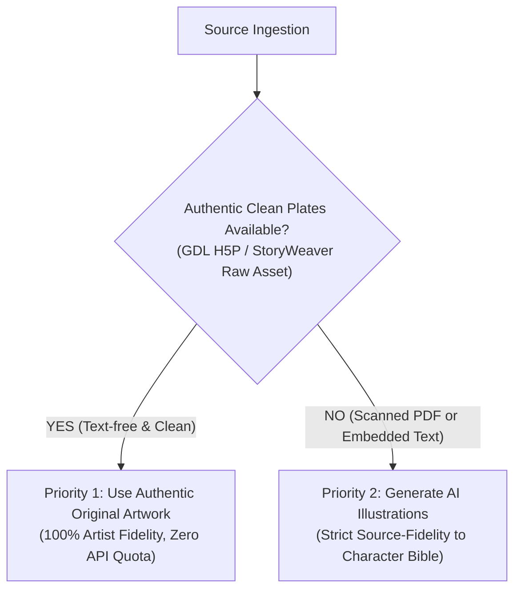

# Story Sourcing & Ingestion Protocols

This document outlines approved sources for free, copyright-free, and Indonesian government storybooks, as well as the text extraction and user review protocols.

---

## 1. Approved Story Repositories

### A. Indonesian Government Educational Repositories

1. **SIBI Kemendikbudristek RI (Sistem Informasi Perbukuan Indonesia)**
   * **URL**: `https://buku.kemdikbud.go.id/`
   * **Content**: Official Indonesian national school textbooks, early reader picture books, and traditional regional folktales (*Timun Mas*, *Lutung Kasarung*, *Bawang Merah Bawang Putih*).
   * **License**: Hak Cipta Kementerian Pendidikan, Kebudayaan, Riset, dan Teknologi RI (Open Educational License).
   * **Usage Rules**: Non-commercial educational distribution permitted. Attribution to *Pusat Perbukuan Kemendikbudristek RI* is mandatory.

2. **Badan Pengembangan dan Pembinaan Bahasa (Kemendikbudristek)**
   * **URL**: `https://badanbahasa.kemdikbud.go.id/`
   * **Content**: Books published under the *Gerakan Literasi Nasional (GLN)* and language conservation programs. Rich in Indonesian values, environmental stewardship, and folklore.
   * **License**: Government Public Educational Resource.

### B. Global Open-License Children's Repositories

3. **StoryWeaver (Pratham Books)**
   * **URL**: `https://storyweaver.org.in/`
   * **Content**: Over 50,000 multilingual children's books across 300+ languages, created by prominent international authors and illustrators.
   * **License**: Creative Commons Attribution 4.0 International (**CC BY 4.0**).
   * **Usage Rules**: Allows remixing, commercial and non-commercial adaptation, and derivative video creation provided proper credit is given to author and illustrator.

4. **Global Digital Library (GDL)**
   * **URL**: `https://digitallibrary.io/`
   * **Content**: Curated open reading resources aligned with UNESCO goals, featuring high-quality Indonesian translations.
   * **License**: CC BY 4.0 or Open Creative License.

5. **Let's Read Asia (The Asia Foundation)**
   * **URL**: `https://letsreadasia.org/`
   * **Content**: Culturally relevant children's literature from Asia and the Pacific.
   * **License**: CC BY-NC 4.0 or CC BY 4.0.

---

## 2. Local Duplicate Detection Protocol

Before initializing or scaffolding a new story, always check `stories/<book-slug>/story.json`:

```bash
# Check if title directory or story.json already exists
test -f "stories/<book-slug>/story.json" && echo "EXISTING_STORY_FOUND"
```

If an existing story is found locally, **never silently overwrite it**. Always present the user with a decision card:

| Option | Action | Blast Radius & Reversibility |
| :--- | :--- | :--- |
| **Option 1 (Recommended): Resume & Incremental Edit** | Re-uses existing cached plates and voiceovers; only generates missing or explicitly targeted scenes. | Zero data loss; fastest execution (~30s). Fully reversible. |
| **Option 2: Create New Version** | Scaffolds under `stories/<book-slug>-v2/`, preserving the previous project intact. | Zero risk to original project. |
| **Option 3: Complete Fresh Overwrite** | Clears existing assets and re-ingests the manuscript from scratch. | High blast radius: deletes cached artwork and audio. |

---

## 3. Artwork Ingestion Priority Ladder

Never confuse **scanned book pages** (which degrade video quality with baked-in typography and paper creases) with **authentic clean digital plates**.



### Priority 1: Authentic Clean Open Digital Artwork
Check if the open-license repository hosts clean, text-free illustration plates:
* **Global Digital Library (GDL) H5P**: Extracts raw illustration plates (`/images/p-*.jpg`) without text overlays.
* **StoryWeaver Raw Assets**: CC BY 4.0 high-res illustration bundles.
* **When Found**: Use them directly! Guarantees 100% authentic author and illustrator vision, zero hallucinations, and zero API quota consumption.

### Priority 2: AI Illustration Generation (Source-Fidelity Rule)
When authentic clean artwork is unavailable (e.g., source only has raster scans with baked-in foreign text or no illustrations):
* **Strict Source Fidelity**: The AI prompt **must** faithfully extract and adhere to the character physical traits (hair, garments, color palette, props, species) and environmental biome explicitly described in the manuscript.
* **Negative Constraints**: Always enforce `--no text, no watermark, no typography, no letters, no subtitles`.

---

## 4. User Review Checkpoint Card

Before generating illustrations or synthesizing voiceovers, the agent must present a structured proposal to the user for confirmation:

```markdown
### 📖 Storybook Ingestion & Production Brief

- **Book Title**: [Indonesian / Localized Title]
- **Original Title**: [Original Title if translated]
- **Author**: [Author Name]
- **Original Illustrator / Source**: [e.g., Priya Kuriyan / StoryWeaver or Kemendikbudristek]
- **Source URL**: [Direct link to official repository page]
- **License**: [e.g., CC BY 4.0 / Lisensi Terbuka Kemendikbudristek RI]
- **Target Audience**: Early Readers (Ages 4–8)
- **Proposed Pacing**: 3 scenes (Shorts/Reels, ~25s) or extended 6–8 scenes (YouTube, ~60s)

#### Clean Narrative Manuscript & Scene Breakdown:
| Scene # | Narrative Text | Shot & Camera Motion | Visual Action | Foley & ASMR Audio Cue |
| :--- | :--- | :--- | :--- | :--- |
| **Scene 1** | "[Spoken narrative text...]" | Slow Push-in (`scale: 1.08 -> 1.20`) | [Subject, action, setting] | [Tactile sound effect cue] |
| **Scene 2** | "[Spoken narrative text...]" | Pan Right (`x: -45px -> +45px`) | [Subject, action, setting] | [Tactile sound effect cue] |
| **Scene 3** | "[Spoken narrative text...]" | Tilt Up (`y: +35px -> -35px`) | [Subject, action, setting] | [Tactile sound effect cue] |

#### Proposed Visual Medium:
[ ] Whimsical Fairytale Watercolor (soft wet-on-wet washes)
[ ] Folk Art Gouache (artisan textured brushstrokes)
```

> **File-First Principle**: Always write the complete brief to `stories/<book-slug>/raw/user-review-card.md` in the title's project directory first before presenting the summary card in chat. The user must approve or revise the narrative before audio synthesis and image generation proceed.
