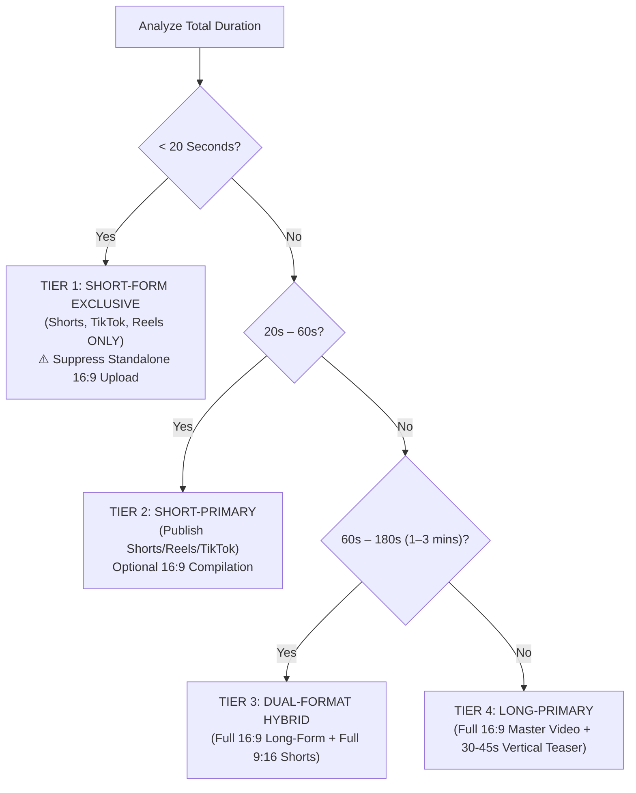

# Video Duration Strategy & Platform Best Practices

This guide establishes the algorithmic, audience engagement, and platform-specific duration guidelines for publishing children's storybooks across **YouTube (Long-Form & Shorts)**, **TikTok**, and **Instagram Reels**.

---

## 1. Cross-Platform Research & Duration Benchmark

| Platform | Format | Max Limit | Algorithmic Sweet Spot | Audience Retention Behavior | Best Practice for Storybooks |
| :--- | :--- | :--- | :--- | :--- | :--- |
| **YouTube Long-Form** | 16:9 Landscape | Unlimited | **3 – 8 minutes** (or 10–20 min compilations) | Viewers expect complete narrative arcs, soothing bedtime pacing, and chapter navigation on TV/Desktop/Tablet. Standalone videos under 60s suffer heavy bounce rates. | Full animated reading experience with calm ambient Foley, full scene chapters, CC BY 4.0 attribution, and bedtime SEO. |
| **YouTube Shorts** | 9:16 Vertical | **180 seconds (3 mins)** *(Updated Q4 2024)* | **15 – 60 seconds** *(Peak completion >85%)* | Completion rate and swipe-away rate determine distribution velocity. 15–30s micro-stories loop effortlessly; 60–180s full stories require strong pacing. | Hook in first 2 seconds. Use dynamic kinetic subtitles and active spoken-word glow. Link to full 16:9 video via "Related Video" feature. |
| **TikTok** | 9:16 Vertical | 10 minutes | **21 – 34 seconds** (viral) / **60 – 90 seconds** (storytime) | Attention span is shortest. Drop-off occurs within first 3 seconds if visual action or text hook is delayed. | High-contrast visual opener, relatable humor/curiosity hook, sound-driven Foley, and bold captions in safe zones. |
| **Instagram Reels** | 9:16 Vertical | 90s (in-app) / 15m (API) | **7 – 30 seconds** (audio trend) / **30 – 60 seconds** (narrative) | Algorithm strongly suppresses Reels >90 seconds in Explore/Reels tab. Highest reach achieved when viewers watch 100% and re-loop or share to DMs. | Keep under 60–90 seconds. If a story exceeds 90s, publish a punchy 30–45s highlight/teaser directing to full story link in bio. |

---

## 2. The 4-Tier Storybook Publication Taxonomy

The production engine automatically calculates total runtime (`totalDurationSeconds = sum(scenes.durationSeconds)`) and assigns the optimal publishing strategy:

---

### Tier 1: Micro-Story / Visual Joke / Moral Riddle (`< 20 seconds`)
* **Classification**: `SHORT_ONLY` (Short-Form Exclusive).
* **Target Channels**: **YouTube Shorts (9:16)**, **TikTok (9:16)**, **Instagram Reels (9:16)**.
* **16:9 Long-Form Handling**: **SUPPRESS STANDALONE UPLOAD**.
  * *Reasoning*: A 12–18 second horizontal video uploaded as a standard YouTube video damages channel watch-time metrics, produces a jarring viewer experience on TV/desktop screens, and gets buried by YouTube's horizontal recommendation engine.
  * *Compilation Strategy*: Archive the 16:9 render for bundling into a multi-story compilation (e.g. *“5 Dongeng Lucu 1 Menit”*) once 4–5 micro-stories are created.
* **Editing & Subtitle Rules**:
  * Visual pace: Snappy cuts (1.5s – 2.5s per beat).
  * Subtitle placement: Center-bottom (`bottom: 260px` in 9:16) with high-contrast text stroke.
  * Captions: Under 100 characters with curiosity gap: e.g. *“Tebak apa yang terjadi selanjutnya?! 😱 #Shorts”*.

---

### Tier 2: Snackable Mini-Story (`20 – 60 seconds`)
* **Classification**: `SHORT_PRIMARY` (Shorts First).
* **Target Channels**: **YouTube Shorts (9:16)**, **TikTok (9:16)**, **Instagram Reels (9:16)**.
* **16:9 Long-Form Handling**: Optional.
  * If uploaded to 16:9, must include a clear playlist tag and end screen pointing to longer videos.
* **Editing & Subtitle Rules**:
  * Pacing: 2.0s – 3.0s per phrase.
  * Full-sentence context subtitles with active spoken word bounce.
  * Natural narrative arc: Hook (0–3s) $\to$ Climax (15–30s) $\to$ Punchline/Moral (40–55s).

---

### Tier 3: Standard Children's Picture Book (`60 – 180 seconds / 1 – 3 minutes`)
* **Classification**: `DUAL_HYBRID` (Full Bilingual Long-Form & Full Shorts).
* **Target Channels**:
  * **YouTube Long-Form (16:9)**: Full illustrated storybook experience with scene chapters, soothing bedtime voiceover, and CC BY 4.0 credits.
  * **YouTube Shorts (9:16)**: Full vertical reading experience (compliant with YouTube's 180s Shorts limit).
  * **TikTok (9:16)**: Full vertical video or two-part series if pacing demands.
  * **Instagram Reels (9:16)**:
    * If runtime $\le$ 90s: Full Reel upload.
    * If runtime $>$ 90s: Curate a 45–60s highlight Reel ending on a cliffhanger, pointing to the full YouTube link in bio.
* **Editing & Subtitle Rules**:
  * 16:9 uses gentle Ken Burns pan & zoom with warm parchment backdrop.
  * 9:16 uses ambient blur pillarbox with centerpiece character card.
  * Kinetic karaoke subtitles in both formats adhering strictly to respective UI safe-zones.

---

### Tier 4: Extended Bedtime Tale / Multi-Chapter Folklore (`> 180 seconds / > 3 minutes`)
* **Classification**: `LONG_PRIMARY` (Widescreen Bedtime Master).
* **Target Channels**: **YouTube Long-Form (16:9)** as the centerpiece asset.
* **YouTube Duplicate Protection Rule**:
  * **STRICT PROHIBITION**: **DO NOT** upload full 3+ minute vertical (9:16) videos to YouTube. YouTube strictly caps Shorts at 180s (3 minutes); anything longer is forcibly demoted to the standard "Videos" tab with letterbox black bars, creating an exact content duplicate next to the 16:9 widescreen master video.
  * The upload engine (`upload-youtube.ts`) automatically forces `--format landscape` when `durationTier === "tier4"`.
* **Short-Form Handling (Instagram Reels / Facebook Reels / TikTok)**:
  * Full vertical 9:16 cuts are published to Instagram Reels and Facebook Reels.
  * For TikTok / Shorts hooks: Generate a dedicated 30–45s Vertical Teaser / Hook Reel highlighting the most exciting 2 scenes and concluding with an animated call-to-action card: *"Tonton kisah lengkapnya di YouTube @ZaynAdyanRamadhan! 🌟 Link di bio/deskripsi!"*.

---

## 3. Automated Strategy Enforcement Matrix

| Metric | Tier 1 (< 20s) | Tier 2 (20s – 60s) | Tier 3 (60s – 180s) | Tier 4 (> 180s) |
| :--- | :--- | :--- | :--- | :--- |
| **Strategy Code** | `short-only` | `short-primary` | `dual-hybrid` | `long-primary` |
| **YouTube Default** | 🛑 **Suppress 16:9** (Shorts Only) | ⚠️ Warn / Optional 16:9 | ✔️ **Publish 16:9** (Landscape Hero) | ✔️ **Publish 16:9** (Strictly Landscape Only) |
| **YouTube 9:16 Action**| ✔️ **Publish Shorts** (Hero Asset) | ✔️ **Publish Shorts** (Optional) | ⚠️ **Optional Shorts** (Keep Channel Clean) | 🛑 **STRICTLY BLOCKED** (>180s creates Videos tab duplicate) |
| **YouTube Tags** | `#Shorts #StoryShorts` | `#Shorts #DongengAnak` | Full SEO + `#Shorts` | Full SEO, Bedtime, Education |
| **Instagram Reels** | Full (<20s Loop) | Full (High Reach) | Full (with R2 Protected Cover) | Full (9:16 Widescreen-In-Canvas) |
| **Facebook Reels** | Full (<20s Loop) | Full (High Reach) | Full (9:16 Vertical) | Full (9:16 Vertical) |
| **TikTok** | Full (Peak Loop) | Full (High Retention) | Full (Storytime) | 30–45s Teaser or Multi-Part |
